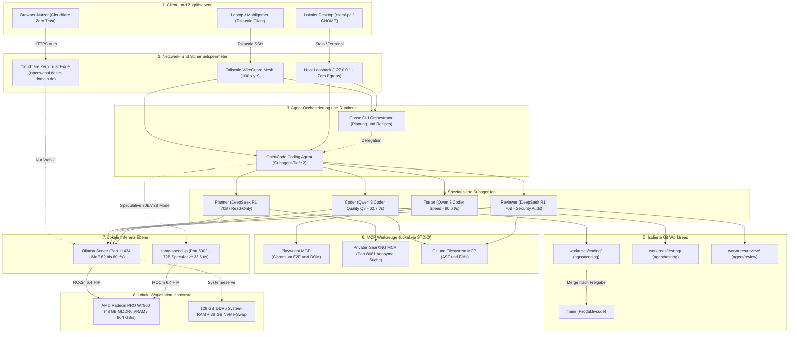
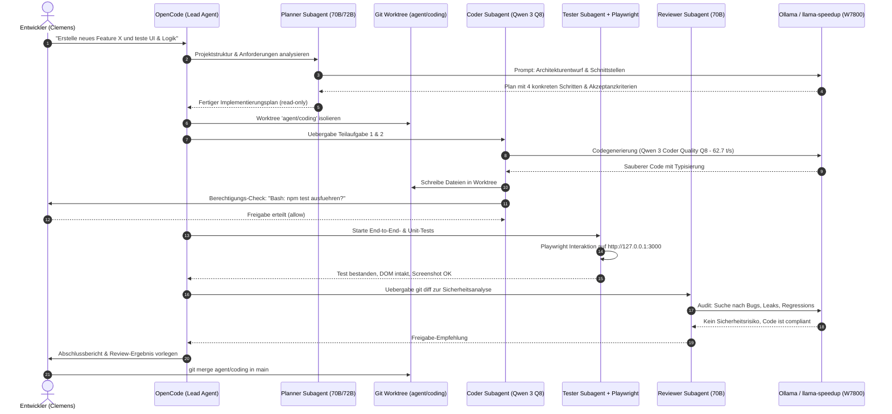

# 🏛️ Lokale Multi-Agent-Architektur & Tool-Interaktion
## Vollständige Systemarchitektur für AMD Radeon Pro W7800, Tailscale, Cloudflare, Ollama & llama-speedup

> **System:** AMD Radeon PRO W7800 (48 GB GDDR6 VRAM, 384-Bit Bus, Netto ~44,4 GiB) | 128 GB RAM | Ubuntu Linux (ROCm 6.4 nativ)  
> **Netzwerk:** Tailscale (`100.x.y.z`), Cloudflare Zero Trust (`openwebui.deine-domain.de`), Loopback (`127.0.0.1`)  
> **Agent-Runtimes:** OpenCode (Primary Coding Agent), Goose (Orchestrator & Recipes), MCP Tools

---

## 🗺️ 1A. Grafische Gesamtübersicht (Kopierbares ASCII-Architekturdiagramm)

*(Tipp: Über das Kopieren-Symbol oben rechts im Codeblock lässt sich diese Grafik 1:1 in Notizen, Dokumente oder Terminals einfügen)*

```text
╔══════════════════════════════════════════════════════════════════════════════════════════════╗
║                                 1. CLIENT- & ZUGRIFFSEBENE                                   ║
╚══════════════════════╤════════════════════════════════════════╤══════════════════════════════╝
                       │                                        │
       ┌───────────────┴───────────────┐        ┌───────────────┴───────────────┐
       ▼                               ▼        ▼                               ▼
┌─────────────────────────────┐ ┌──────────────────────┐ ┌─────────────────────────────────────┐
│ 🌐 Browser-Client (Extern)  │ │ 🖥️ Lokaler Desktop   │ │ 💻 Laptop / Mobilgerät (Unterwegs)  │
│ HTTPS Auth                  │ │ (clemi-pc / GNOME)   │ │ Direktes P2P über Tailscale VPN     │
└──────────────┬──────────────┘ └──────────┬───────────┘ └──────────────────┬──────────────────┘
               │                           │                                │
╔══════════════╪═══════════════════════════╪════════════════════════════════╪══════════════════╗
║              ▼             2. NETZWERK- & SICHERHEITSPERIMETER            ▼                  ║
║ ┌─────────────────────────┐   ┌──────────────────────┐   ┌─────────────────────────────────┐ ║
║ │ Cloudflare Zero Trust   │   │ Host Loopback        │   │ Tailscale WireGuard Mesh        │ ║
║ │ openwebui.deine-domain.de│   │ 127.0.0.1            │   │ IP: 100.x.y.z (Tailscale)  │ ║
║ │ [Nur WebUI / 100s Limit]│   │ [Zero-Data-Egress]   │   │ [Kein Timeout / E2E SSH & CLI]  │ ║
║ └────────────┬────────────┘   └──────────┬───────────┘   └────────────────┬────────────────┘ ║
╚══════════════╪═══════════════════════════╪════════════════════════════════╪══════════════════╝
               │                           └───────────────┬────────────────┘
               ▼                                           ▼
┌─────────────────────────────┐         ╔══════════════════════════════════════════════════════╗
│ 🐳 Open WebUI (Port 3000)   │         ║         3. AGENT-ORCHESTRIERUNG & RUNTIMES           ║
│ (Docker ai-network)         │         ║                                                      ║
└──────────────┬──────────────┘         ║  ┌────────────────────────────────────────────────┐  ║
               │                        ║  │ 🪿 Goose CLI Orchestrator                      │  ║
               │                        ║  │ • High-Level Task-Planung & Recipes (32k Ctx)  │  ║
               │                        ║  └───────────────────────┬────────────────────────┘  ║
               │                        ║                          │ Delegation                ║
               │                        ║                          ▼                           ║
               │                        ║  ┌────────────────────────────────────────────────┐  ║
               │                        ║  │ 🤖 OpenCode Coding Agent (Lead Agent)          │  ║
               │                        ║  │ • Subagent-Tiefe: 2 | Permissions: ask / allow │  ║
               │                        ║  └─────┬───────────┬─────────────┬───────────┬────┘  ║
               │                        ╚════════╪═══════════╪═════════════╪═══════════╪═══════╝
               │                                 │           │             │           │
               │                 ┌───────────────┘           │             │           └──────────────┐
               │                 ▼                           ▼             ▼                          ▼
               │      ┌─────────────────────┐   ┌────────────────────┐   ┌────────────────────┐   ┌────────────────────┐
               │      │ 📐 Planner Subagent │   │ 💻 Coder Subagent  │   │ 🧪 Tester Subagent │   │ 🔍 Reviewer Agent  │
               │      │ • DeepSeek R1 70B / │   │ • Qwen 3 Coder Q8  │   │ • Qwen 3 Speed     │   │ • DeepSeek R1 70B  │
               │      │   Qwen 72B Spec.    │   │   (62.7 t/s)       │   │   (80.6 t/s)       │   │ • Security Audit   │
               │      │ • Read-Only         │   │ • Write/Edit: true │   │ • Playwright E2E   │   │ • Read-Only        │
               │      └──────────┬──────────┘   └─────────┬──────────┘   └─────────┬──────────┘   └─────────┬──────────┘
               │                 │                        │                        │                        │
               │                 │              ╔═════════╪════════════════════════╪════════════════════════╪══════════╗
               │                 │              ║         ▼     4. ISOLIERTE GIT WORKTREES                  ▼          ║
               │                 │              ║  • worktrees/coding/  (Branch: agent/coding)  ──► Merge nach main/   ║
               │                 │              ║  • worktrees/testing/ (Branch: agent/testing)                        ║
               │                 │              ║  • worktrees/review/  (Branch: agent/review)                         ║
               │                 │              ╚═════════╤════════════════════════╤════════════════════════╤══════════╝
               │                 │                        │                        │                        │
               │                 │              ╔═════════╪════════════════════════╪════════════════════════╪══════════╗
               │                 │              ║         ▼     5. LOKALE MCP-WERKZEUGE (STDIO)             ▼          ║
               │                 ├─────────────►║  🔍 Privater SearXNG MCP  (Port 8081 Docker, 100% anonyme Websuche)  ║
               │                 │              ║  🎭 Playwright MCP        (Lokaler Chromium Browser, DOM, Shots)     ║
               │                 │              ║  📁 Git & Filesystem MCP  (AST-Navigation, Diff-Analyse)             ║
               │                 │              ╚═════════╤════════════════════════╤════════════════════════╤══════════╝
               │                 │                        │                        │                        │
               └────────────────►├────────────────────────┴────────────────────────┴────────────────────────┘
                                 ▼
╔══════════════════════════════════════════════════════════════════════════════════════════════════════════════════════╗
║                              6. LOKALE INFERENZ-EBENE & HARDWARE (AMD RADEON PRO W7800)                              ║
║                                                                                                                      ║
║  ┌────────────────────────────────────────────────────────┐  ┌────────────────────────────────────────────────────┐  ║
║  │ 🦙 Ollama Server (Host Port 11434 / ROCm 6.4)          │  │ ⚡ llama-speedup (Host Port 5002 / llama-swap)      │  ║
║  │ • Flash Attention 1 | KV-Cache: q4_0 | 32k Kontext     │  │ • Speculative Decoding (Draft-Modelle & N-Gram)    │  ║
║  │ • qwen3-coder-quality (Q8_0): 62.7 t/s (33.5 GB VRAM)  │  │ • qwen2.5-72b-speculative:       33.6 t/s (+269%)  │  ║
║  │ • qwen3-coder-speed (Q4_K_M): 80.6 t/s (20.6 GB VRAM)  │  │ • llama3.3-70b-abliterated-spec: 30.0 t/s (+201%)  │  ║
║  │ • qwen3.8-35b-distill (Q6_K): 66.6 t/s (30.4 GB VRAM)  │  │ • qwen2.5-coder-32b-speculative: 60.0 t/s          │  ║
║  └───────────────────────────┬────────────────────────────┘  └─────────────────────────┬──────────────────────────┘  ║
║                              └────────────────────────────┬────────────────────────────┘                             ║
║                                                           ▼                                                          ║
║        🔥 AMD Radeon PRO W7800 (48 GB GDDR6 VRAM, 384-Bit Bus, 864 GB/s)  |  128 GB DDR5 RAM  |  ROCm 6.4            ║
╚══════════════════════════════════════════════════════════════════════════════════════════════════════════════════════╝
```

---

## 🗺️ 1B. Grafische Gesamtübersicht (Interaktives Mermaid-Diagramm)

*(Bereinigte Syntax ohne Sonderzeichen-Konflikte)*



---

## 🔄 2. Dynamischer Ablauf: Von der Aufgabe zum getesteten Code



---

## 🧩 3. Komponenten & Werkzeug-Funktionsmatrix

| Komponente | Rolle im Setup | Host / Port | VRAM / Ressource | Sicherheits- & Sandbox-Regel |
| :--- | :--- | :--- | :--- | :--- |
| **Goose CLI** | Generalistischer Orchestrator | CLI (Host / Tailscale SSH) | CPU / Shell | Führt keine zerstörerischen Befehle ohne Bestätigung aus |
| **OpenCode CLI** | Spezialisierter Coding-Agent | CLI (Host / Tailscale SSH) | CPU / Node.js | Subagent-Tiefe 2; `permission.bash = ask` |
| **Planner Subagent** | Architektur & Schritt-Planung | OpenCode Subagent | DeepSeek-R1-70B / Qwen 72B | `write: false`, `edit: false`, `bash: false` (Streng lesend) |
| **Coder Subagent** | Code-Generierung & Refactoring | OpenCode Subagent | Qwen 3 Coder Quality (62.7 t/s) | `write: true`, `edit: true`, `bash: ask` (Nur im Worktree) |
| **Tester Subagent** | QA, Unit-Tests, Browser E2E | OpenCode Subagent | Qwen 3 Coder Speed (80.6 t/s) | Steuert Playwright lokal; `bash: ask` |
| **Reviewer Subagent** | Unabhängiges Audit & Security | OpenCode Subagent | DeepSeek-R1-70B | `write: false`, `edit: false`, `bash: false` (Audit-only) |
| **Playwright MCP** | Headless/GUI Web-Testing | Stdio (`npx @playwright/mcp`) | RAM (~400 MB) | Zugriff nur auf `127.0.0.1` und Tailscale-IPs |
| **SearXNG MCP** | Private, anonyme Websuche | Stdio (`mcp_searxng_bridge.py`) | Docker (Port 8081) | Keine Cookies, kein Logging, keine externen Google-APIs |
| **Git Worktrees** | Dateisystem- & Branch-Isolierung | `projects/worktrees/*` | NVMe-Speicherplatz | Verhindert Überschreiben durch parallele Agenten |
| **Ollama** | Primäre MoE & Dense Inferenz | Host Port 11434 (ROCm 6.4) | 48 GB W7800 VRAM | Gebunden an Tailscale & Localhost; Flash Attention |
| **llama-speedup** | Speculative Decoding (70B/72B) | Host Port 5002 (`llama-swap`) | 48 GB W7800 VRAM | +269 % Speedup bei 72B durch Draft-Modelle |
