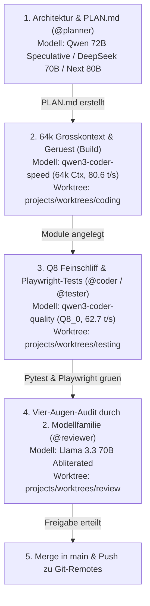

# 🌳 Git Worktrees & Multi-Agenten-Workflow
## Konfliktfreie, parallele Softwareentwicklung durch isolierte Dateisystem-Branches

> **Grundsatz:** Mehrere KI-Agenten dürfen niemals gleichzeitig im selben Dateisystem-Verzeichnis dieselben Dateien bearbeiten.  
> **Lösung:** Git Worktrees koppeln getrennte Dateipfade an separate Git-Branches desselben Repositories.

---

## 🏛️ 1. Arbeitsbereich-Architektur

```text
/home/clemi/Projekte/LLM/agent-cli-setup/
├── .git/                           ──► Haupt-Repository (Branch: main)
│
└── projects/
    ├── remote-backup.git/          ──► Lokales Bare-Remote Backup
    └── worktrees/
        ├── coding/                 ──► Branch: agent/coding   (@coder: Implementierung)
        ├── testing/                ──► Branch: agent/testing  (@tester: Pytest & Playwright)
        └── review/                 ──► Branch: agent/review   (@reviewer: Vier-Augen-Audit)
```

Jedes dieser Verzeichnisse ist ein eigenständiger Ordner auf deiner NVMe-SSD, teilt sich aber die identische `.git`-Objektdatenbank.

---

## 🚀 2. Automatisierte Einrichtung der Worktrees

Das Skript [`scripts/setup_worktrees.sh`](file:///home/clemi/Projekte/LLM/agent-cli-setup/scripts/setup_worktrees.sh) richtet die Struktur automatisch ein:

```bash
cd /home/clemi/Projekte/LLM/agent-cli-setup
./scripts/setup_worktrees.sh
```

---

## 🏆 3. Die zwei Großprojekt-Abläufe (Schnell vs. Maximale Qualität)

Du kannst jedes größere Projekt auf zwei Arten durch die Worktrees steuern:

### Variante A: Single-Model-Durchlauf (Modi 1–5 — 0s Wechselzeit)
* **Wann nutzen:** Für normale Features und schnelle Iterationen.
* **Modell-Empfehlung für großen Kontext:** **Modus 2 (`ollama/qwen3-coder-speed` mit `64k Kontext` & `80,6 t/s`)** oder **Modus 1 (`ollama/qwen3-coder-quality` Q8_0 mit `62,7 t/s`)**.
* **Vorteil:** Alle Rollen (`@planner`, `@coder`, `@tester`, `@reviewer`) nutzen dasselbe Modell im VRAM – **0,0 Sekunden Wartezeit** beim Rollenwechsel!

---

### Variante B: Multi-Model-Großprojekt-Ablauf (Modus 6 / `multimodel_project_workflow.sh`)
* **Wann nutzen:** Für komplexe Großprojekte, neue Architekturen und sicherheitskritischen Code.
* **Prinzip:** Jede Projektphase nutzt das dafür stärkste Spezialmodell – und das abschließende Review erfolgt im **echten Vier-Augen-Prinzip durch eine zweite Modellfamilie (Llama 70B prüft Qwen-Code)**!

#### 1-Klick-kopierbares ASCII-Ablaufdiagramm (Großprojekt-Pipeline)

```text
+===================================================================================+
| SCHRITT 1: ARCHITEKTUR & PLAN.md (@planner)                                       |
| Modell:    Qwen 2.5 72B Speculative (Port 5002) / DeepSeek R1 70B / Next 80B      |
| Aktion:    Analysiert Projektstruktur & schreibt modulare Checkliste in PLAN.md   |
+-----------------------------------------+-----------------------------------------+
                                          | (VRAM-Wechsel ~12s)
                                          v
+===================================================================================+
| SCHRITT 2: 64k GROSSKONTEXT-ANALYSE & GRUNDGERÜST (Build im coding/-Worktree)     |
| Modell:    ollama/qwen3-coder-speed (Q4_K_M | 64.536 Tokens Kontext! | 80,6 t/s)  |
| Aktion:    Liest bis zu 64k Tokens Code ein & erstellt alle Module laut PLAN.md   |
+-----------------------------------------+-----------------------------------------+
                                          | (VRAM-Wechsel ~10s)
                                          v
+===================================================================================+
| SCHRITT 3: Q8 PRÄZISIONS-CODING & E2E-TESTS (@coder & @tester)                    |
| Modell:    ollama/qwen3-coder-quality (Q8_0 verlustfrei | 62,7 t/s + Playwright)  |
| Aktion:    Feinschliff im coding/-Worktree + pytest & /webtest im testing/-Tree   |
+-----------------------------------------+-----------------------------------------+
                                          | (VRAM-Wechsel ~14s)
                                          v
+===================================================================================+
| SCHRITT 4: UNABHÄNGIGES 70B VIER-AUGEN-REVIEW (@reviewer im review/-Worktree)     |
| Modell:    llama3.3-70b-abliterated (Zweite Modellfamilie: Llama 70B statt Qwen!) |
| Aktion:    Prüft git diff main..agent/coding unzensiert auf Bugs & Security       |
+-----------------------------------------+-----------------------------------------+
                                          |
                                          v
+===================================================================================+
| SCHRITT 5: MERGE & PUSH                                                           |
| Befehl:    git checkout main && git merge agent/coding && git push origin main    |
+===================================================================================+
```

#### Vertikales Mermaid-Diagramm (`flowchart TD`)



#### Startbefehle für den Großprojekt-Ablauf:
```bash
# Interaktives Menü für den Multi-Model-Großprojekt-Workflow:
./scripts/multimodel_project_workflow.sh

# Oder direkt den geführten 4-Phasen-Staffellauf starten:
./scripts/multimodel_project_workflow.sh pipeline
```

---

## 🧹 4. Bereinigung & Zurücksetzen

Nach Abschluss eines Features können die Worktrees schnell zurückgesetzt oder aufgeräumt werden:

```bash
# Aktive Worktrees anzeigen:
git worktree list

# Worktree entfernen (Dateien löschen, Repository bleibt intakt):
git worktree remove worktrees/coding
git worktree prune
```

