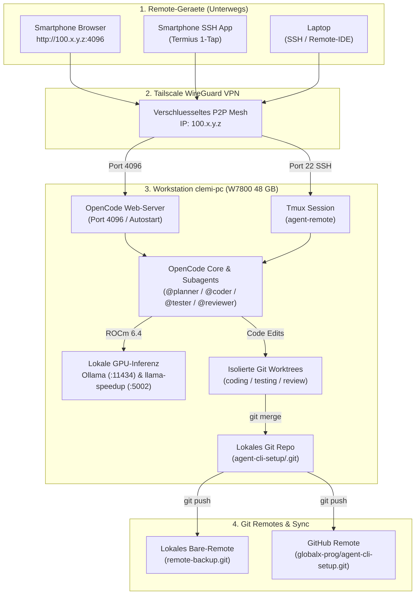

# 📱💻 Praxis-Leitfaden: Große Projekte (32k), Alltag & Remote-Zugriff (Laptop / Handy)
## Kompletthandbuch inkl. Git-Architektur & kopierbarem Mermaid-Quellcode

> **Host:** `clemi-pc` (`100.x.y.z` im Tailscale WireGuard Mesh)  
> **Inferenz:** AMD Radeon PRO W7800 (48 GB VRAM) | `qwen3-coder-quality` (62,7 t/s)  
> **Git Remote:** `git@github.com:globalx-prog/agent-cli-setup.git`

---

## 📱💻 1. Nutzung von Remote-Laptop oder Smartphone (Handy)

Es gibt **drei praxiserprobte Wege**, um deine lokale Multi-Agent-CLI von unterwegs (Laptop, Tablet oder Smartphone) zu steuern. Alle drei laufen **100 % Ende-zu-Ende-verschlüsselt über Tailscale (`100.x.y.z`)** ohne offene Router-Ports.

### Weg A: Vom Remote-Laptop via SSH + Tmux (Der Profi-Weg)
Deine W7800 (48 GB), deine Repositories und deine MCP-Server laufen direkt auf `clemi-pc`. Vom Laptop aus verbindest du dich mit einem einzigen Befehl in eine **persistente Tmux-Sitzung**:

```bash
# Auf dem Laptop (Terminal / PowerShell / iTerm2) bei aktivem Tailscale:
ssh clemi@100.x.y.z -t "/home/clemi/Projekte/LLM/agent-cli-setup/scripts/remote_agent.sh tmux"
```
* **Der Clou:** Wenn du auf dem Laptop einen großen Auftrag startest und den Laptop zuklappst (oder das WLAN im Zug abbricht), **läuft OpenCode auf `clemi-pc` einfach weiter!** Beim erneuten Verbinden siehst du sofort das fertige Ergebnis.

---

### Weg B: Vom Smartphone (Handy) im Browser via `opencode web` (Bequemste Touch-Bedienung)
Auf einer kleinen Handy-Tastatur sind Terminal-Shortcuts (`Tab`, `Strg+C`) oft fummelig. OpenCode besitzt deshalb ein **eingebautes Web-Interface**, das wir exklusiv an deine Tailscale-IP binden:

1. **Starte auf `clemi-pc` (oder einmalig per SSH vom Handy) den Web-Modus:**
   ```bash
   /home/clemi/Projekte/LLM/agent-cli-setup/scripts/remote_agent.sh web
   ```
2. **Öffne auf dem Handy (Safari / Chrome, mit eingeschalteter Tailscale-App):**
   👉 **`http://100.x.y.z:4096`**
3. **Ergebnis:** Du hast eine vollwertige, mobilfreundliche Oberfläche für OpenCode inkl. `@planner`, `@coder`, Datei-Diffs und Berechtigungs-Buttons direkt im Handy-Browser!

---

### Weg C: Vom Smartphone per SSH-App (Termius / ConnectBot / Termux:Widget)
Wenn du auch am Android-Handy echtes Terminal bevorzugst, gibt es **4 erstklassige Android-Lösungen für den 1-Tap-Sofortzugriff**:

| Android-App / Methode | Besonderer Vorteil auf Android | Einrichtung für 1-Tap-Start auf `clemi-pc` (`100.x.y.z`) |
| :--- | :--- | :--- |
| **1. OpenCode Web als Android-PWA** *(Chrome / Brave)* | **Bequemste Touch-App** ohne kleine Terminal-Schrift; echte Buttons für `Allow`/`Deny` & 1-Klick-Copy. | `http://100.x.y.z:4096` in Chrome öffnen -> Menü (`⋮`) -> **„Zum Startbildschirm hinzufügen“**. Startet danach im Vollbild wie eine native App! |
| **2. ConnectBot / JuiceSSH** *(Play Store / F-Droid)* | **Echte Android-Homescreen-Shortcuts (1-Tap-Icons)** direkt in die laufende Session. | Host `clemi@100.x.y.z` mit Startbefehl `/home/clemi/Projekte/LLM/agent-cli-setup/scripts/remote_agent.sh tmux` anlegen -> Lange auf den Android-Homescreen drücken -> **ConnectBot-Shortcut-Widget** ablegen! |
| **3. Termius** *(Play Store)* | Beste Spezial-Tastenleiste (`Tab`, `Esc`, `Strg`, `/`, `@`), SFTP-Dateidownload & Fingerabdruck-Login. | Host `100.x.y.z`, User `clemi`, unter *Startup Snippet*: `/home/clemi/Projekte/LLM/agent-cli-setup/scripts/remote_agent.sh tmux` eintragen. |
| **4. Termux + Termux:Widget** *(F-Droid — Power-User)* | Eigene **Android-Homescreen-Button-Leiste** für OpenCode, VRAM-Flush, GPU-Boost & Status! | Skripte in `~/.shortcuts/` auf dem Handy ablegen (z. B. `ssh clemi@100.x.y.z -t ".../remote_agent.sh tmux"`) und als Widget auf den Homescreen ziehen. |

---

### Weg D: OpenCode lokal auf dem Laptop, aber GPU-Power von `clemi-pc` nutzen
Falls der Quellcode direkt auf deinem Laptop liegt und du nur die 48 GB VRAM deiner W7800 zuhause anzapfen willst:
* Trage in der `~/.config/opencode/opencode.json` **auf deinem Laptop** einfach die Tailscale-IP als `baseURL` ein:
  ```json
  "baseURL": "http://100.x.y.z:11434/v1"
  ```

---

## 🗺️ 2. Grafische Darstellung: Remote-Zugriff & Git-Architektur (Lesbares Hochformat)

### A. Direkt kopierbares ASCII-Diagramm (1-Klick Copy oben rechts)

```text
+===================================================================================+
| 1. REMOTE-GERÄTE (Unterwegs: Smartphone, Tablet, Laptop)                          |
|                                                                                   |
|  [Smartphone Browser]          [Smartphone Termius App]       [Remote-Laptop]     |
|  http://100.x.y.z:4096    1-Tap SSH + Tmux Attach        SSH + Tmux / IDE    |
+--------------+----------------------------+--------------------------+------------+
               |                            |                          |
               +----------------------------+--------------------------+
                                            |
                                            v
+===================================================================================+
| 2. TAILSCALE WIREGUARD MESH VPN (Ende-zu-Ende verschlüsselt, 0 offene Ports)      |
|    Ziel-Knoten: clemi-pc (100.x.y.z) | Optional: openwebui.deine-domain.de    |
+-------------------------------------------+---------------------------------------+
                                            |
                       +--------------------+--------------------+
                       | (Port 4096)                             | (Port 22 SSH)
                       v                                         v
+===================================================================================+
| 3. WORKSTATION CLEMI-PC (AMD Radeon PRO W7800 - 48 GB VRAM)                       |
|                                                                                   |
|  [OpenCode Web-Server (systemd Autostart)]      [Persistente Tmux-Session]        |
|                       \                                       /                   |
|                        +------------------+------------------+                    |
|                                           |                                       |
|                                           v                                       |
|               [OpenCode Core + Subagents (@planner / @coder / @reviewer)]         |
|                                           |                                       |
|              +----------------------------+----------------------------+          |
|              | (Inferenz 62-80 t/s)                                    | (Edits)  |
|              v                                                         v          |
|  [Ollama :11434 & llama-speedup :5002]          [Isolierte Git Worktrees]         |
|  - qwen3-coder-speed (64k Großkontext)          - worktrees/coding/               |
|  - qwen3-coder-quality (Q8_0 Präzision)         - worktrees/testing/              |
|  - qwen2.5-72b / llama3.3-70b / next80b         - worktrees/review/               |
+------------------------------------------------------------------------+----------+
                                                                         |
                                                                         | git push
                                                                         v
+===================================================================================+
| 4. GIT BACKUP & GERÄTE-SYNCHRONISATION                                            |
|  - Lokales Bare-Remote: projects/remote-backup.git                                |
|  - GitHub Remote:       git@github.com:globalx-prog/agent-cli-setup.git           |
+===================================================================================+
```

### B. Vertikales Mermaid-Diagramm (`flowchart TD` — optimal lesbar auf allen Bildschirmen)



### C. Kopierbarer Mermaid-Quellcode (zum direkten Kopieren)

```text
flowchart TD
    subgraph REMOTE["1. Remote-Geraete (Unterwegs)"]
        PhoneWeb["Smartphone Browser (http://100.x.y.z:4096)"]
        PhoneSSH["Smartphone SSH App (Termius 1-Tap)"]
        Laptop["Laptop (SSH / Remote-IDE)"]
    end

    subgraph TAILNET["2. Tailscale WireGuard VPN"]
        TS_Tunnel["Verschluesseltes P2P Mesh (100.x.y.z)"]
    end

    subgraph HOST["3. Workstation clemi-pc (W7800 48 GB)"]
        OCWeb["OpenCode Web-Server (Port 4096)"]
        TmuxSess["Tmux Session (agent-remote)"]
        OCCore["OpenCode Core & Subagents (@planner / @coder / @reviewer)"]
        Ollama["Ollama (:11434) & llama-speedup (:5002)"]
        Worktrees["Isolierte Worktrees (coding / testing / review)"]
        LocalGit["Lokales Git Repo (agent-cli-setup/.git)"]
    end

    subgraph GITHUB["4. Git Remotes & Sync"]
        LocalBare["Lokales Bare-Remote (remote-backup.git)"]
        GHRepo["GitHub Remote (globalx-prog/agent-cli-setup.git)"]
    end

    PhoneWeb --> TS_Tunnel
    PhoneSSH --> TS_Tunnel
    Laptop --> TS_Tunnel
    TS_Tunnel -->|Port 4096| OCWeb
    TS_Tunnel -->|Port 22| TmuxSess
    OCWeb --> OCCore
    TmuxSess --> OCCore
    OCCore --> Ollama
    OCCore --> Worktrees
    Worktrees --> LocalGit
    LocalGit --> LocalBare
    LocalGit --> GHRepo
```

---

## 🏗️ 3. Große Projekte umsetzen (32k / 64k Strategie & Multi-Model-Ablauf)

### A. Die 5 goldenen Regeln für große Repositories
1. **Für große Kontexte Modus 2 (`qwen3-coder-speed` mit 64k!) wählen:** Weil `qwen3-coder-speed` (`Q4_K_M`) nur ~18,5 GB für die Gewichte braucht, stehen ihm volle **64.536 Tokens Kontextfenster** bei **80,6 t/s** zur Verfügung.
2. **Subagenten isolieren den Kontext automatisch:** Jeder Aufruf von `@planner`, `@coder`, `@tester` oder `@reviewer` startet ein **eigenes, leeres Kontextfenster**. Liest der Subagent 15.000 Tokens an Dateien, werden diese nach seiner Antwort verworfen – dein Haupt-Chat erhält nur die kompakte Zusammenfassung.
3. **`/init` & `AGENTS.md` nutzen:** Einmalig `/init` im Projekt ausführen. Die erzeugte `AGENTS.md` dient als permanente Architektur-Landkarte auf der SSD.
4. **`PLAN.md` als externes Gedächtnis:** Lass `@planner` größere Aufgaben in eine `PLAN.md` mit Checkboxen (`- [ ] Modul 1`) schreiben.
5. **`/compact` nach jedem Meilenstein:** Sobald ein Teil-Feature fertig ist, `/compact` tippen (komprimiert 25k Chat-Tokens auf ~1k Tokens).

### B. Der 4-Phasen-Großprojekt-Ablauf mit unterschiedlichen Spezialmodellen
Wenn du bei einem großen Projekt maximale Ergebnisqualität willst (statt 1 Modell für alles), starte [`./scripts/multimodel_project_workflow.sh`](file:///home/clemi/Projekte/LLM/agent-cli-setup/scripts/multimodel_project_workflow.sh) (oder **Modus 6** in `start_agent_session.sh`):
1. **Phase 1 — Architektur (`72B Speculative` / `DeepSeek-R1-70B` / `Next-80B`):** Entwirft `PLAN.md` mit allen Modul-Schnittstellen.
2. **Phase 2 — Großkontext-Gerüst (`qwen3-coder-speed`, 64k Ctx):** Liest große Dateibäume ein und baut die Grundstruktur im `coding/`-Worktree.
3. **Phase 3 — Präzisions-Coding & Tests (`qwen3-coder-quality`, Q8_0):** Verfeinert den Code und führt `pytest` sowie Playwright-Browsertests (`/webtest`) aus.
4. **Phase 4 — Vier-Augen-Security-Review (`llama3.3-70b-abliterated`):** Ein 70B-Llama-Modell prüft den Qwen-Code als unabhängige zweite Modellfamilie!

---

## 📋 4. Ausgaben aus OpenCode kopieren & Troubleshooting (`Connection refused`)

### A. Wie kopiere ich Text oder Code aus der OpenCode-Oberfläche?
1. **Mit der Maus im Terminal:** Halte die **`Shift`-Taste** gedrückt, markiere den Text mit der linken Maustaste und drücke **`Strg + Shift + C`** (umgeht den Maus-Scroll-Modus der TUI).
2. **Sauberer Markdown-Export ohne Rahmen (`┃`):** Tippe in OpenCode **`/export`**.
3. **Im `Tmux Studio`:** Drücke **`Strg + B`** und danach **`[`** (Scroll- & Copy-Modus, Beenden mit `q`).
4. **Im Handy-/Laptop-Browser (`Port 4096`):** Nutze den direkten **1-Klick-Copy-Button** über jedem Codeblock.

### B. Lösung bei `Connection refused` vom Remote-Laptop / Smartphone
* **Ursache 1 (SSH Port 22):** Auf `clemi-pc` fehlte das Paket `openssh-server`. Einmalig beheben mit:
  ```bash
  sudo apt update && sudo apt install -y openssh-server && sudo systemctl enable --now ssh
  ```
* **Ursache 2 (Web-UI Port 4096):** Der `opencode web`-Server lief noch nicht. Dauerhaft als Autostart-Service aktivieren mit:
  ```bash
  /home/clemi/Projekte/LLM/agent-cli-setup/scripts/autostart_remote_service.sh enable
  ```

---

## ⚖️ 4. Stärken vs. Verzicht (Zusammenfassung)

### ✅ Was ist richtig stark?
* **100 % Datenschutz & Zero-Egress:** Kein Byte Quellcode oder `.env`-Secret verlässt dein System.
* **0,00 € laufende API-Kosten:** Unbegrenzte Agenten-Läufe, Refactorings und Test-Schleifen.
* **Zensurfreie Security-Audits:** Jederzeit umschaltbar auf `qwen3-obliterated` oder `llama3.3-70b-abliterated-speculative`.
* **Hohe MoE-Geschwindigkeit:** `62,7 t/s` (`qwen3-coder-quality` Q8) bzw. `80,6 t/s` (`qwen3-coder-speed`).
* **Lokales Playwright & SearXNG:** Testet interne Web-Apps (`127.0.0.1`) und sucht anonym über eigenen SearXNG-Container (`Port 8081`).

### ❌ Worauf musst du verzichten?
* **Kein 1M-Token-Kontext:** Du kannst nicht 50 Dateien ungefiltert auf einmal in den Chat kopieren (Arbeiten in Teilaufgaben + `/compact` nötig).
* **Langsamerer Prefill bei Riesen-Prompts:** 16k Tokens Einlesen dauert ~9–10 s (MoE) bzw. ~80 s (70B), während Cloud-Flash <1 s benötigt.
* **Immer nur 1 großes Modell gleichzeitig im VRAM:** Wegen 48 GB VRAM und `OLLAMA_MAX_LOADED_MODELS=1` dauert ein Modellwechsel auf ein anderes Gewicht ~10–15 s Ladezeit von der SSD.

