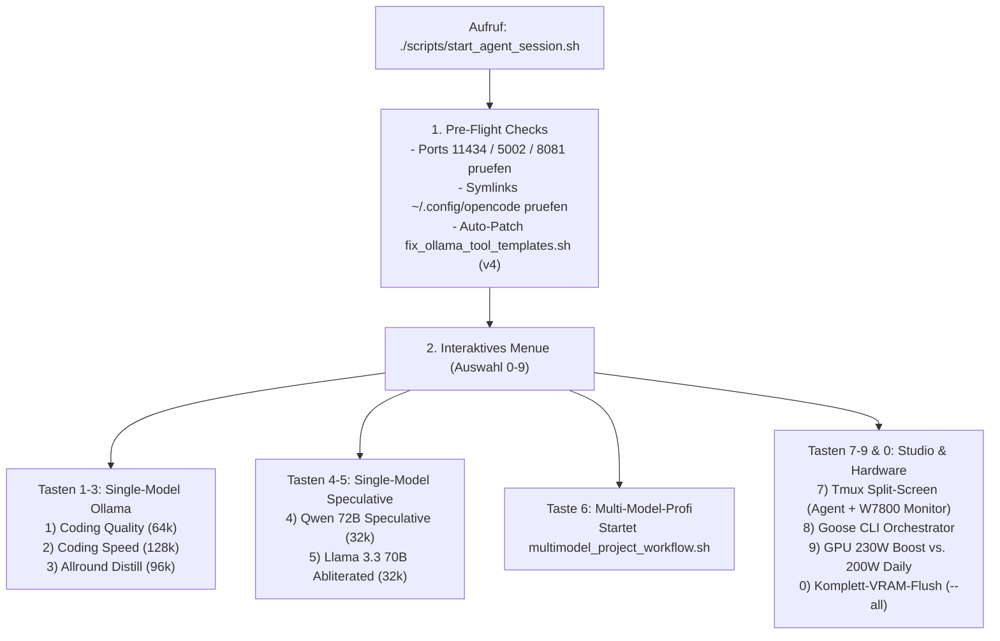
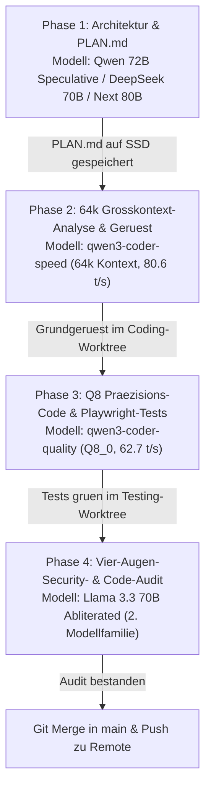
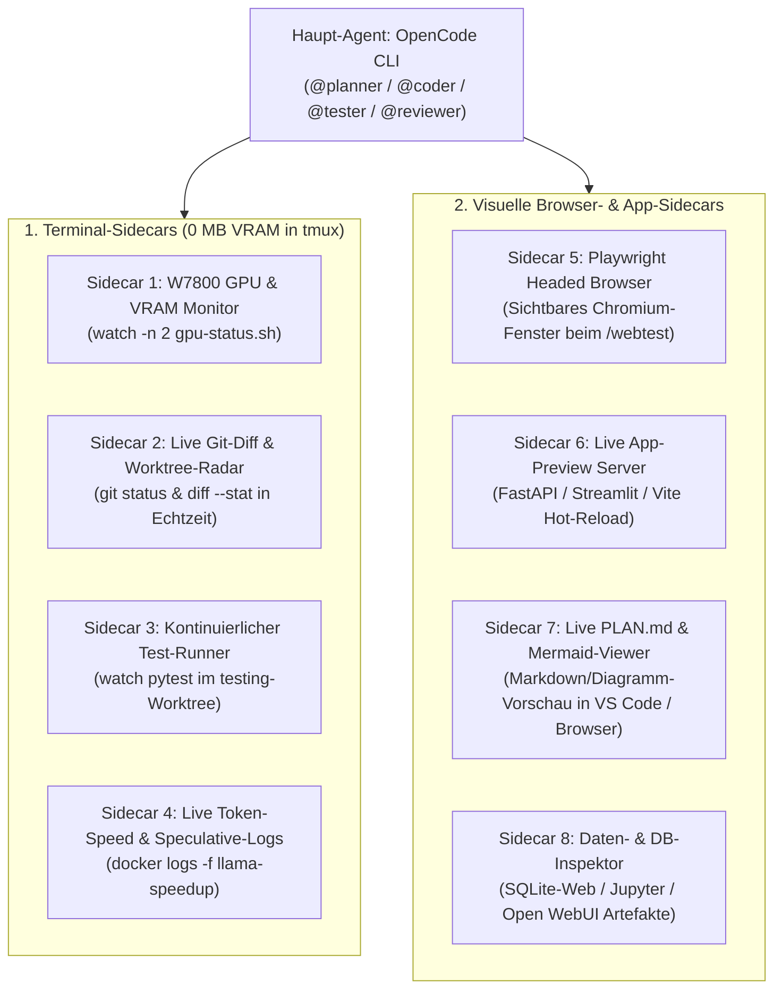

# 🏆 Kompletthandbuch: Befehle, Multi-Model-Großprojekte, Modelle (64k / 80B), Websuche, Sidecars & Autostart

> **System:** `clemi-pc` | AMD Radeon PRO W7800 (48 GB GDDR6 VRAM) | Tailscale `100.x.y.z`  
> **Zweck:** Zentrales Nachschlagewerk für alle wichtigen Befehle, Tipps, Großprojekt-Workflows mit unterschiedlichen Modellen, Websuche-Mechanismen, grafische IDE-/Sidecar-Erweiterungen, Geräte-Synchronisation und System-Autostart.

---

## ⌨️ 1. Wichtige Befehle, Shortcuts & Profi-Tipps (Spickzettel)

### A. In der OpenCode CLI / Web-Oberfläche
| Befehl / Taste | Funktion | Profi-Tipp für den Alltag |
| :--- | :--- | :--- |
| **`/init`** | Analysiert das Projekt und erstellt eine `AGENTS.md` | **Immer als Erstes** in einem neuen Projekt ausführen – spart tausende Kontext-Tokens! |
| **`/compact`** | Komprimiert den bisherigen Chat-Verlauf auf die Kernfakten | Nach jedem abgeschlossenen Teil-Feature tippen, damit der 32k/64k-Kontext frisch bleibt. |
| **`/undo`** / **`/redo`** | Macht die letzte Datei-Änderung des Agenten sofort rückgängig | Nutzt intern Git-Snapshots – du kannst gefahrlos experimentieren. |
| **`/models`** | Modell mitten in der Sitzung wechseln | Z. B. von `qwen3-coder-speed` (64k Lesen) auf `qwen3-coder-quality` (Q8 Schreiben) umschalten. |
| **`/plan <Aufgabe>`** | Startet `@planner` (Read-Only) für einen 3-Punkte-Plan | Verhindert voreiliges Ändern von Dateien bei komplexen Fragen. |
| **`/suche <Begriff>`** | Erzwingt sofortige anonyme Websuche über lokales SearXNG (`:8081`) | Holt aktuelle Doku, Release-Notes oder Fehlermeldungen ins Kontextfenster. |
| **`/webtest <URL>`** | Startet `@tester` mit lokalem Headless-Playwright-Chromium | Prüft laufende Web-Apps (`http://127.0.0.1:3000`, `:8081`) live im DOM. |
| **`/review <Pfad>`** | Startet `@reviewer` (Read-Only) für Security- & Bug-Audit | Im Multi-Model-Modus prüft hier ein 70B-Llama-Modell deinen Qwen-Code! |
| **`Tab`-Taste** | Wechselt unten links den primären Agenten (`Build` ↔ `Plan` ↔ `Coder`) | Schneller als `@coder` einzutippen, wenn du länger in einer Rolle bleibst. |
| **`@dateiname`** | Fügt eine bestimmte Datei gezielt in den Prompt ein | Viel sparsamer für den Kontext als den Agenten erst 20 Dateien suchen zu lassen. |

### B. Im Linux-Terminal (`agent-cli-setup/`)
```bash
# 1. Haupt-Launcher (Modi 1-5: Single-Model 0s | Modus 6: Multi-Model-Spezialisten)
./scripts/start_agent_session.sh

# 2. Multi-Model-Großprojekt-Workflow direkt starten (oder geführte 4-Phasen-Pipeline)
./scripts/multimodel_project_workflow.sh

# 3. Remote-Zugriff für Laptop (tmux) oder Handy-Browser (Port 4096) starten
./scripts/remote_agent.sh tmux
./scripts/remote_agent.sh web

# 4. Autostart-Status prüfen & Handy-Webserver (Port 4096) als Systemstart-Dienst aktivieren
./scripts/autostart_remote_service.sh status
./scripts/autostart_remote_service.sh enable

# 5. Direkte SearXNG-Websuche im Terminal ohne LLM-Wartezeit
./scripts/suche.sh "Suchbegriff"
```

---

## 🛠️ 1b. Alle Funktionen von `start_agent_session.sh` & Zusammenspiel der 9 Skripte

### A. Was passiert beim Start von `scripts/start_agent_session.sh`? (Ablaufdiagramm)

```text
+===================================================================================+
| AUFRUF: ./scripts/start_agent_session.sh                                          |
+-----------------------------------------+-----------------------------------------+
                                          |
                                          v
+===================================================================================+
| 1. AUTOMATISCHE PRE-FLIGHT-CHECKS (Vor dem Auswahlmenü)                           |
|  - Setzt PATH auf ~/.opencode/bin & ~/.local/bin                                  |
|  - Prüft Port 11434 (Ollama), Port 5002 (llama-speedup), Port 8081 (SearXNG)      |
|  - Prüft Symlinks in ~/.config/opencode (führt sonst 03-link-agent-configs.sh aus)|
|  - Prüft /tmp/.qwen3_tool_template_patched_v4 (führt sonst Tool/Kontext-Patch aus)|
|  - Liest aktuelles Hauptmodell aus configs/opencode.json                          |
+-----------------------------------------+-----------------------------------------+
                                          |
                                          v
+===================================================================================+
| 2. INTERAKTIVES AUSWAHLMENÜ (Tasten 0 bis 9)                                      |
+------+------------------+------------------+------------------+-------------------+
       |                  |                  |                  |
   [Taste 1-3]        [Taste 4-5]         [Taste 6]        [Taste 7 / 8 / 9 / 0]
  Ollama-Modus     Speculative 70B/72B   Multi-Model      Studio & Hardware-Tools
       |                  |                  |                  |
       v                  v                  v                  v
  1. Entlädt         1. Entlädt         Startet           - 7: Tmux Split-Screen
     Port 5002          Ollama 11434    multimodel_         (OpenCode + GPU-Status)
  2. Resetet         2. Resetet         project_          - 8: Goose CLI Session
     agents/*.md        agents/*.md     workflow.sh       - 9: 230W Boost / 200W
  3. Setzt model &   3. Setzt model &   (Spezialisten       Lüfter-Umschaltung
     small_model        small_model      pro Rolle)       - 0: Vollständiger
  4. Startet         4. Startet                             VRAM- & Swap-Flush
     opencode           opencode
```



### B. Referenz-Tabelle aller 9 Skripte in `agent-cli-setup/scripts/`

| Skript | Hauptfunktion & Parameter | Wann wird es aufgerufen? |
| :--- | :--- | :--- |
| **[`start_agent_session.sh`](file:///home/clemi/Projekte/LLM/agent-cli-setup/scripts/start_agent_session.sh)** | Zentraler Launcher mit Pre-Flight-Checks, `set_single_model_mode()`, VRAM-Kollisionsschutz und 10 Menü-Aktionen (`0`–`9`). | Täglicher Einstiegspunkt am PC oder per SSH. |
| **[`multimodel_project_workflow.sh`](file:///home/clemi/Projekte/LLM/agent-cli-setup/scripts/multimodel_project_workflow.sh)** | Steuert den Großprojekt-Modus (`enable`, `enable-next80b`, `pipeline`, `reset`): Weist jeder Rolle (`@planner`, `Build`, `@coder`, `@reviewer`) ihr Spezialmodell zu oder führt durch den 4-Phasen-Staffellauf. | Bei Großprojekten (oder über Taste `6` im Haupt-Launcher). |
| **[`free_agent_vram.sh`](file:///home/clemi/Projekte/LLM/agent-cli-setup/scripts/free_agent_vram.sh)** | Gezieltes Entladen des VRAMs: `--only-ollama` (entlädt Port 11434), `--only-speedup` (entlädt Port 5002), `--all` (entlädt beide + ComfyUI + Swap). | Automatisch durch `start_agent_session.sh` beim Moduswechsel oder manuell über Taste `0`. |
| **[`fix_ollama_tool_templates.sh`](file:///home/clemi/Projekte/LLM/agent-cli-setup/scripts/fix_ollama_tool_templates.sh)** | Patcht die Qwen3-Modelle in Ollama mit dem JSON-`<tool_call>`-Template (getrennte `if .Content` / `if .ToolCalls` Blöcke) und setzt die Max-Kontexte (`128k`, `96k`, `64k`). | Automatisch beim ersten Start von `start_agent_session.sh` (oder nach Modell-Updates). |
| **[`remote_agent.sh`](file:///home/clemi/Projekte/LLM/agent-cli-setup/scripts/remote_agent.sh)** | Startet den Fernzugriff über Tailscale (`100.x.y.z`): Parameter `tmux` (persistente SSH-Session) oder `web` (`opencode web` auf Port `4096`). | Vom Laptop per SSH oder manuell für Smartphone-Zugriff. |
| **[`autostart_remote_service.sh`](file:///home/clemi/Projekte/LLM/agent-cli-setup/scripts/autostart_remote_service.sh)** | Prüft den System-Autostart aller Dienste (`status`) und installiert/entfernt den `systemd --user` Dienst `opencode-web.service` (`enable` / `disable`). | Einmalig zur Aktivierung des Handy-Webservers (`Port 4096`) beim Booten. |
| **[`mcp_searxng_bridge.py`](file:///home/clemi/Projekte/LLM/agent-cli-setup/scripts/mcp_searxng_bridge.py)** | JSON-RPC 2.0 MCP-Server (`stdio`), der Suchanfragen des Agenten (`local-searxng_searxng_web_search`) an den lokalen SearXNG-Docker-Container (`:8081`) weiterleitet. | Vollautomatisch im Hintergrund durch OpenCode & Goose. |
| **[`suche.sh`](file:///home/clemi/Projekte/LLM/agent-cli-setup/scripts/suche.sh)** | Schnelle Kommandozeilen-Websuche über SearXNG (`Port 8081`) direkt im Linux-Terminal mit farbiger Titel-/URL-Ausgabe. | Direkt im Terminal: `./scripts/suche.sh "Begriff"`. |
| **[`setup_worktrees.sh`](file:///home/clemi/Projekte/LLM/agent-cli-setup/scripts/setup_worktrees.sh)** & **[`status.sh`](file:///home/clemi/Projekte/LLM/agent-cli-setup/scripts/status.sh)** | `setup_worktrees.sh` legt die isolierten Branches (`coding/`, `testing/`, `review/`) an; `status.sh` zeigt W7800-Thermik, Lüfter, VRAM und Port-Status. | Bei Projekt-Initialisierung bzw. zur schnellen Systemdiagnose. |

---

## 🧠 2. Modell-Empfehlungen: `qwen3-coder-speed` für große Kontexte (64k+) & `Qwen3-Next-80B` als DeepSeek-Alternative

### A. Warum `qwen3-coder-speed` der Geheimtipp für riesige Kontexte (128k Tokens!) ist
Auf einer 48 GB Grafikkarte konkurrieren **Modellgewichte** und **KV-Cache (Kontextfenster)** um denselben VRAM:
1. **`qwen3-coder-quality` (`Q8_0`)** belegt für die Gewichte ~32,0 GB VRAM. Mit `q4_0` KV-Cache erreicht es jetzt **volle `64k` (`65.536` Tokens) Default-Kontext** (~35,5 GB Gesamt-VRAM, +9,5 GB Reserve).
2. **`qwen3-coder-speed` (`Q4_K_M`)** benötigt für die Modellgewichte nur **~18,5 GB VRAM**. Dadurch bleiben auf deiner W7800 (45,0 GiB Netto) **über 26 GB freier VRAM allein für den KV-Cache** übrig! Selbst bei **vollen `128k` (`131.072` Tokens) Default-Kontext** belegt es insgesamt nur **~24,5 GB VRAM** (und lässt immer noch >20 GB VRAM frei!).
3. **Extremer Prefill-Durchsatz (`1.573 t/s`) & Generierung (`80,6 t/s`):** Da bei der MoE-Architektur pro Token nur **3,3 Milliarden Parameter** aktiv gerechnet werden, liest `qwen3-coder-speed` ein komplettes Repository mit 50.000+ Tokens in wenigen Sekunden ein.
4. **Bereits aktiv umgesetzt:** [`scripts/fix_ollama_tool_templates.sh`](file:///home/clemi/Projekte/LLM/agent-cli-setup/scripts/fix_ollama_tool_templates.sh) und [`configs/opencode.json`](file:///home/clemi/Projekte/LLM/agent-cli-setup/configs/opencode.json) konfigurieren automatisch:
   - `qwen3-coder-speed` -> **`128k` (`131.072` Tokens)**
   - `qwen3.8-35b-distill` -> **`96k` (`98.304` Tokens)**
   - `qwen3-coder-quality` -> **`64k` (`65.536` Tokens)**
   - `qwen2.5-72b` / `llama3.3-70b` -> **`32k` (`32.768` Tokens)** (`deepseek-r1-70b-speculative` -> **`40k`**)

### B. `Qwen3-Next-80B` (`next80b-32k`) als überlegene DeepSeek-R1-70B-Alternative in Zukunft
Warum löst die **Qwen-80B-MoE-Generation (`qwen3-next-80b` / `next80b-32k`)** künftig `deepseek-r1-70b-speed` ab?

| Kriterium | `deepseek-r1-70b-speed` *(Bisher)* | `Qwen3-Next-80B` / `next80b-32k` *(Zukunft)* |
| :--- | :--- | :--- |
| **Architektur** | Dichter (Dense) Llama-3.3-70B-Distill (alle 70B Parameter pro Token aktiv) | **80B MoE (Mixture-of-Experts)** – 80B Gesamtwissen, aber nur kleiner Teil pro Token aktiv |
| **Geschwindigkeit (W7800)** | ~13,1 t/s (bandbreitenlimitiert bei 864 GB/s) | **Deutlich höherer Token-Durchsatz** durch sparsame MoE-Aktivierung |
| **Tool-Calling in OpenCode** | `<think>`-Monologe verbrauchen viele Tokens vor dem eigentlichen JSON-Tool-Call | **Natives Qwen-Tool-Calling** (direkte, stabile `<tool_call>`-JSON-Ausgabe) |
| **Kontext-Effizienz** | Denkschritte (`<think>`) füllen das 32k-Fenster schnell auf | Volles 32k/64k-Fenster steht für echten Projekt-Code zur Verfügung |
| **Integration im Setup** | Verfügbar als `ollama/deepseek-r1-70b-speed` | Bereits vorintegriert als `ollama/next80b-32k` in [`configs/opencode.json`](file:///home/clemi/Projekte/LLM/agent-cli-setup/configs/opencode.json) & [`multimodel_project_workflow.sh`](file:///home/clemi/Projekte/LLM/agent-cli-setup/scripts/multimodel_project_workflow.sh) |

---

## 🏗️ 3. Workflow für große Projekte mit UNTERSCHIEDLICHEN Modellen (Multi-Model Quality Pipeline)

Für schnelle Aufgaben im Alltag nutzt du **Modus 1–5** (1 Modell für alle Rollen = 0s Ladezeit).  
Für **große, anspruchsvolle Projekte** liefert jedoch ein **Multi-Model-Workflow** das mit Abstand beste Ergebnis – auch wenn jeder Phasenwechsel ~10–15 Sekunden zum Nachladen des Spezialmodells in den VRAM benötigt.

### Warum liefert Multi-Model bessere Ergebnisse?
1. **Kein „Self-Bias" (Vier-Augen-Prinzip zwischen Qwen & Llama):** Wenn ein Qwen-Modell Code schreibt und dasselbe Qwen-Modell ihn danach reviewt, übersieht es oft seine eigenen logischen blinden Flecken. Prüft stattdessen ein **70B-Llama-3.3-Modell** (`@reviewer`) den Code des **Qwen3-Coders** (`@coder`), findet es deutlich mehr Edge-Cases!
2. **Optimale Arbeitsteilung nach Hardware-Stärke:**
   - **64k Kontext-Breite** (`qwen3-coder-speed`) zum Einlesen großer Dateibäume.
   - **70B/72B/80B Logik-Tiefe** (`qwen2.5-72b-speculative`, `deepseek-r1-70b` oder `next80b-32k`) für die Architektur in `PLAN.md`.
   - **Q8_0 Quantisierungs-Präzision** (`qwen3-coder-quality`) für fehlerfreien Code & Playwright-Tests.

### Architektur des 4-Phasen-Multi-Model-Workflows (ASCII & Mermaid)

```text
+===================================================================================+
| PHASE 1: ARCHITEKTUR & DEEP PLANNING (@planner)                                   |
| Modell:  qwen2.5-72b-speculative (Port 5002) ODER deepseek-r1-70b / next80b-32k   |
| Output:  Schreibt modulare Architektur & Checkliste in 'PLAN.md' auf die SSD      |
+-----------------------------------------+-----------------------------------------+
                                          | (VRAM-Switch ~12s)
                                          v
+===================================================================================+
| PHASE 2: 64k GROSSKONTEXT-ANALYSE & GRUNDGERÜST (Build)                           |
| Modell:  ollama/qwen3-coder-speed (Q4_K_M | 64.536 Tokens Kontext! | 80,6 t/s)    |
| Output:  Liest bis zu 64k Projektdateien gleichzeitig & baut das Modul-Gerüst     |
+-----------------------------------------+-----------------------------------------+
                                          | (VRAM-Switch ~10s)
                                          v
+===================================================================================+
| PHASE 3: Q8 PRÄZISIONS-CODING & AUTOMATISIERTE TESTS (@coder & @tester)           |
| Modell:  ollama/qwen3-coder-quality (Q8_0 verlustfrei | 62,7 t/s + Playwright)    |
| Output:  Feinschliff der Algorithmen, führt pytest & Browser-Tests (/webtest) aus |
+-----------------------------------------+-----------------------------------------+
                                          | (VRAM-Switch ~14s)
                                          v
+===================================================================================+
| PHASE 4: UNABHÄNGIGES 70B VIER-AUGEN-AUDIT (@reviewer)                            |
| Modell:  llama3.3-70b-abliterated (Andere Modellfamilie: Llama 70B statt Qwen!)   |
| Output:  Unzensiertes Security- & Logik-Review des Git-Diffs vor dem Merge        |
+===================================================================================+
```



### So startest du den Multi-Model-Workflow in der Praxis:
```bash
# Entweder über das Hauptmenü (Taste 6):
./scripts/start_agent_session.sh

# Oder direkt über das Workflow-Skript:
./scripts/multimodel_project_workflow.sh
```
Dort hast du die Wahl zwischen:
1. **Automatische Rollen-Spezialisierung innerhalb einer OpenCode-Session (`Auswahl 1` oder `2`):** `@planner` nutzt automatisch 70B/80B, der Hauptagent `qwen3-coder-speed` (64k), `@coder`/`@tester` nutzen `qwen3-coder-quality` (Q8) und `@reviewer` nutzt `llama3.3-70b-abliterated-speed`.
2. **Geführter 4-Phasen-Staffellauf (`Auswahl 3`):** Wechselt nacheinander sogar zwischen `llama-speedup` (Port 5002, 72B Speculative) und `Ollama` (Port 11434, 64k Speed & Q8 Quality) inkl. sauberem VRAM-Flush zwischen den Phasen!

---

## 🔍 4. Wie ist die Websuche implementiert? Muss ich sie immer manuell anfragen?

### A. Technische Implementierung (100 % lokal & anonym)
1. **Such-Engine:** Dein lokaler Docker-Container **`searxng`** läuft isoliert auf `127.0.0.1:8081` (Metasuchmaschine ohne Tracking-Cookies oder Nutzerprofil).
2. **MCP-Brücke:** Unser Python-Skript [`scripts/mcp_searxng_bridge.py`](file:///home/clemi/Projekte/LLM/agent-cli-setup/scripts/mcp_searxng_bridge.py) wird von OpenCode beim Start als lokaler MCP-Server (`local-searxng`) per Standard-Ein-/Ausgabe (`stdio` JSON-RPC 2.0) gestartet.
3. **Tool-Registrierung:** Das Skript stellt dem LLM das Werkzeug `local-searxng_searxng_web_search` bereit. Ruft das Modell dieses Tool auf, fragt die Bridge `http://127.0.0.1:8081/search?format=json` ab und liefert die Top-Ergebnisse (Titel, URL, Textauszug) zurück in den Kontext des Modells.

### B. Muss ich die Websuche immer explizit anfragen?
**Nein!** Du hast **3 Möglichkeiten** (von vollautomatisch bis manuell):

1. **Vollautomatisch durch den Agenten (ohne dass du `/suche` tippst):**
   Weil das MCP-Tool global aktiviert ist und wir es in [`planner.md`](file:///home/clemi/Projekte/LLM/agent-cli-setup/configs/agents/planner.md) und [`coder.md`](file:///home/clemi/Projekte/LLM/agent-cli-setup/configs/agents/coder.md) fest verankert haben, entscheidet das Modell bei Fragen zu neuen Versionen, unbekannten APIs oder aktuellen Fehlermeldungen **selbstständig**, das Tool `local-searxng_searxng_web_search` aufzurufen.
   *(Beispiel: „Wie konfiguriere ich in ROCm 6.4 Flash Attention für RDNA3?" -> Der Agent sucht von sich aus in SearXNG).*
2. **Erzwungen per Slash-Command (`/suche`):**
   Wenn du sicherstellen willst, dass das Modell nicht aus seinem Trainingswissen antwortet, sondern **garantiert** live im Web nachschaut, tippst du in OpenCode einfach:
   ```text
   /suche Dein Suchbegriff
   ```
3. **Direkt im Linux-Terminal ohne LLM (`./scripts/suche.sh`):**
   Für eine sekundenschnelle Recherche zwischendurch im Terminal:
   ```bash
   ./scripts/suche.sh "Qwen3 Next 80B GGUF"
   ```

---

## 🖥️ 5. Kann man eine grafische IDE oder Sidecars nachimplementieren / erweitern?

**Ja, problemlos!** Da unsere gesamte Infrastruktur auf offenen Standards (**OpenAI-kompatible Ports `11434` & `5002`**, **MCP-Protokoll** und **Git Worktrees**) aufbaut, lässt sie sich modular um grafische IDEs und Sidecars erweitern:

### A. Grafische IDEs anbinden & Vergleich: Agent-CLI vs. VS Code Editor

| Arbeitsweise | Größte Stärken auf deinem W7800-System | Wann wählen? |
| :--- | :--- | :--- |
| **1. Reine Agent-CLI (`OpenCode` / `Tmux`)** | **0 MB GPU-VRAM-Verbrauch** (volle 48 GB für 70B/72B & 128k Kontext!), extrem kleiner System-Prompt (~2k statt 15k Tokens bei Cline), isolierte Subagenten-Kontexte, 100 % persistent über SSH & Handy (`Port 4096`). | Für große Agenten-Läufe, 70B/72B-Modelle, Multi-Model-Pipelines, Refactorings, Playwright-Tests und Remote-Arbeit. |
| **2. Grafischer Editor (`VS Code`)** | **Visuelle Kontrolle:** Side-by-Side Git-Diffs (einzelne Zeilen per Klick annehmen/ablehnen), `F12` Go-to-Definition, visuelles Breakpoint-Debugging, Dateibaum & Mermaid-Vorschau. | Für manuelles Feintuning, tiefes Debugging mit Haltepunkten und visuelle Endkontrolle vor dem Git-Merge. |
| **3. Der Profi-Hybrid (`OpenCode CLI` IM `VS Code` Terminal)** | Unten im integrierten VS-Code-Terminal arbeitet `opencode` (mit schlankem Prompt & Subagenten), während du oben im Editor live zusiehst, wie Dateien entstehen und Diffs grün/rot markiert werden! | **Beste Kombination am Schreibtisch & Laptop!** *(Profi-Tipp lokal auf `clemi-pc`: Starte VS Code mit `code --disable-gpu`, damit VS Code 0 MB VRAM auf der W7800 belegt!)* |

**Optionen zur VS Code / IDE-Anbindung:**
1. **VS Code / VSCodium / Cursor / Windsurf:**
   - **Profi-Hybrid (Empfohlen):** Öffne das Projekt in VS Code (`code --disable-gpu /home/clemi/Projekte/LLM` oder vom Laptop per **Remote-SSH** auf `clemi@100.x.y.z`) und starte im integrierten Terminal `./agent-cli-setup/scripts/start_agent_session.sh`.
   - **Per Continue.dev / Cline / Roo Code Extension:** Trage in der Extension als Provider `http://127.0.0.1:11434/v1` (oder vom Laptop `http://100.x.y.z:11434/v1` bzw. `:5002/v1`) und denselben MCP-Server (`mcp_searxng_bridge.py`) ein.
2. **Zed Editor (Ultra-schnelle native Linux-IDE):**
   - Unterstützt nativ lokale Ollama-Modelle, OpenAI-Endpunkte (`Port 5002`) und MCP-Server.
3. **OpenCode Web-UI (`http://100.x.y.z:4096`):**
   - Bietet eine grafische Browser-Oberfläche mit klickbaren Sessions, Datei-Diffs und Tool-Freigaben.

### B. Katalog möglicher Sidecar-Erweiterungen (8 konkrete Begleit-Panels)

Ein **Sidecar** ist ein spezialisiertes Zusatzfenster neben dem Haupt-Agenten, das Live-Zustände (Hardware, Code-Diffs, Browser, Tests, Diagramme) in Echtzeit anzeigt, ohne den Chat-Verlauf zu überladen.

#### Architektur des 3-Pane Tmux-Sidecar-Cockpits (Modus `7` in `start_agent_session.sh`)

```text
+================================================+====================================+
|                                                | SIDECAR 1: W7800 GPU & VRAM (Oben) |
|                                                | - Hotspot: 71°C | Lüfter: 65%      |
|   HAUPTFENSTER (Links, 62% Breite):            | - VRAM: 35.5 / 48.0 GB (64k Ctx)   |
|   OpenCode CLI & Subagents                     | - Power: 215W / 230W               |
|   (@planner / @coder / @tester / @reviewer)    +------------------------------------+
|                                                | SIDECAR 2: LIVE GIT & WORKTREES    |
|   Prompt > /plan ...                           | === WORKTREE: CODING ===           |
|   Prompt > @coder ...                          | ## agent/coding                    |
|                                                |  M healthcheck.py  | 42 ++++++--   |
|                                                | === HAUPT-REPO ===                 |
|                                                | ## main...local-backup/main        |
+================================================+====================================+
```



---

#### Die 8 Sidecar-Erweiterungen im Detail (inkl. Aktivieren / Deaktivieren via `sidecar_manager.sh`)

Alle 8 Sidecars sind fertig implementiert und lassen sich einzeln oder als Komplettpaket über [`scripts/sidecar_manager.sh`](file:///home/clemi/Projekte/LLM/agent-cli-setup/scripts/sidecar_manager.sh) (oder über Taste **`s`** in [`scripts/start_agent_session.sh`](file:///home/clemi/Projekte/LLM/agent-cli-setup/scripts/start_agent_session.sh)) ein- und ausschalten:

```bash
# Interaktives Toggle-Menü für alle 8 Sidecars öffnen:
/home/clemi/Projekte/LLM/agent-cli-setup/scripts/sidecar_manager.sh

# Status aller 8 Sidecars live prüfen:
/home/clemi/Projekte/LLM/agent-cli-setup/scripts/sidecar_manager.sh status

# Empfohlenes Komplett-Set (1: GPU + 2: Git + 7: Mermaid-Web + 8: App-Preview) einschalten / alles ausschalten:
/home/clemi/Projekte/LLM/agent-cli-setup/scripts/sidecar_manager.sh all-on
/home/clemi/Projekte/LLM/agent-cli-setup/scripts/sidecar_manager.sh all-off
```

| Nr. | Kurzname | Sidecar-Name & Technik | Befehl zum **Aktivieren (`on`)** | Befehl zum **Deaktivieren (`off`)** |
| :---: | :---: | :--- | :--- | :--- |
| **1** | `gpu` | **🌡️ W7800 GPU-, VRAM- & Thermik-Sidecar** *(Tmux-Pane `@SC1_GPU`)* | `./scripts/sidecar_manager.sh 1 on` *(oder `gpu on`)* | `./scripts/sidecar_manager.sh 1 off` *(oder `gpu off`)* |
| **2** | `git` | **🌳 Live-Git-Diff & Worktree-Radar** *(Tmux-Pane `@SC2_GIT`)* | `./scripts/sidecar_manager.sh 2 on` *(oder `git on`)* | `./scripts/sidecar_manager.sh 2 off` *(oder `git off`)* |
| **3** | `test` | **🧪 Kontinuierlicher TDD-Pytest-Runner** *(Tmux-Pane `@SC3_TEST`)* | `./scripts/sidecar_manager.sh 3 on` *(oder `test on`)* | `./scripts/sidecar_manager.sh 3 off` *(oder `test off`)* |
| **4** | `speed` | **🚀 Token-Speed & Speculative-Logs (`Port 5002`)** *(Tmux-Pane `@SC4_SPEED`)* | `./scripts/sidecar_manager.sh 4 on` *(oder `speed on`)* | `./scripts/sidecar_manager.sh 4 off` *(oder `speed off`)* |
| **5** | `browser` | **🌐 Sichtbares Playwright-Browser-Sidecar** *(Headed Mode in `opencode.json`)* | `./scripts/sidecar_manager.sh 5 on` *(oder `browser on`)* | `./scripts/sidecar_manager.sh 5 off` *(oder `browser off`)* |
| **6** | `plan` | **📋 Live `PLAN.md` Checklisten-Tracker** *(Tmux-Pane `@SC6_PLAN`)* | `./scripts/sidecar_manager.sh 6 on` *(oder `plan on`)* | `./scripts/sidecar_manager.sh 6 off` *(oder `plan off`)* |
| **7** | `docs` | **📊 Live Mermaid & Markdown Web-Viewer (`Port 4097`)** *([`live_mermaid_sidecar.py`](file:///home/clemi/Projekte/LLM/agent-cli-setup/scripts/live_mermaid_sidecar.py))* | `./scripts/sidecar_manager.sh 7 on` *(URL: `http://100.x.y.z:4097`)* | `./scripts/sidecar_manager.sh 7 off` *(oder `docs off`)* |
| **8** | `app` | **🔬 Live Worktree Web-Preview Server (`Port 8090`)** *(HTTP-Preview für `worktrees/coding/`)* | `./scripts/sidecar_manager.sh 8 on` *(URL: `http://100.x.y.z:8090`)* | `./scripts/sidecar_manager.sh 8 off` *(oder `app off`)* |

---

## 🌐 6. Alle Zugriffsmethoden im Überblick & Multi-Geräte-Steuerung vom Handy

### A. Vollständige Matrix aller dokumentierten Zugriffsmethoden

| Zugriffsmethode | Endgerät | Ziel-Adresse / Befehl | Verschlüsselung | Was wird damit gesteuert? |
| :--- | :--- | :--- | :--- | :--- |
| **1. Lokal am Haupt-PC** | `clemi-pc` | `./scripts/start_agent_session.sh` | Lokal (`127.0.0.1`) | Volles Multi-Agent-Setup, Tmux-Studio, GPU-Lüfter/Watt-Steuerung |
| **2. Smartphone Web-UI** | Handy / Tablet (Browser) | **`http://100.x.y.z:4096`** | Tailscale WireGuard | Grafische OpenCode Touch-Oberfläche für alle Projekte auf `clemi-pc` |
| **3. Smartphone SSH-App** | Handy (Termius App) | Host `100.x.y.z` -> `remote_agent.sh tmux` | Tailscale + SSH | Persistente Terminal-Session (läuft bei Verbindungsabbruch weiter) |
| **4. Remote-Laptop SSH** | Laptop (Unterwegs) | `ssh clemi@100.x.y.z -t ".../remote_agent.sh tmux"` | Tailscale + SSH | Volle CLI-Steuerung auf `clemi-pc` bei 0 % Laptop-Akkuverbrauch |
| **5. Laptop-IDE + Remote-GPU** | Laptop (Lokal) | `baseURL: http://100.x.y.z:11434/v1` | Tailscale WireGuard | Lokale Dateien auf dem Laptop bearbeiten, aber W7800 (48 GB) als Gehirn nutzen |
| **6. Cloudflare Web-Chat** | Beliebiges Gerät | `https://openwebui.deine-domain.de` | Cloudflare Zero Trust | Reiner Browser-Chat (Open WebUI), strikt getrennt vom Dateisystem |

---

### B. „Wenn ich am Handy in OpenCode bin, kann ich dann Projekte auf ALLEN meinen Geräten einsehen und steuern?"

Hier gilt eine wichtige Unterscheidung:
1. **Alle Projekte auf `clemi-pc` (Workstation):**
   **JA, sofort und zu 100 %!** Da OpenCode (sowohl über `http://100.x.y.z:4096` als auch über Termius-SSH) direkt auf `clemi-pc` ausgeführt wird, siehst und steuerst du vom Handy aus **jedes Projektverzeichnis auf deiner Workstation** (`/home/clemi/Projekte/...`).
2. **Projekte auf anderen Geräten (z. B. Laptop oder NAS):**
   Ein Handy-Browser kann natürlich nicht auf einen ausgeschalteten Laptop in deiner Tasche zugreifen. Du kannst aber **über zwei Wege alle Geräte verbinden**:
   * **Weg 1: Zentrale Git-Synchronisation (Empfohlen):**
     Alle Projekte liegen auf `clemi-pc` (und werden mit GitHub oder deinem lokalen Bare-Remote synchronisiert). Wenn du unterwegs am Handy ein Feature über OpenCode auf `clemi-pc` programmierst und pusht, tippst du später am Laptop nur `git pull` und hast den neuen Stand sofort auf dem Laptop.
   * **Weg 2: Direktzugriff über das Tailscale-Mesh (SSH / Netzwerk-Mounts):**
     Wenn dein NAS oder dein eingeschalteter Laptop ebenfalls im Tailscale-VPN hängen, kannst du deren Projektordner per **NFS / SMB / SSHFS** unter `/home/clemi/Projekte/nas-projekte/` oder `/home/clemi/Projekte/laptop-mount/` auf `clemi-pc` einbinden (oder den Agenten per `ssh laptop "..."` Befehle ausführen lassen). Dann kannst du vom Handy aus tatsächlich live Dateien auf allen eingeschalteten Geräten in deinem Tailscale-Netz einsehen und steuern!

---

## 🔄 7. Starten all diese Funktionen automatisch mit dem System (`clemi-pc`)?

Hier ist der exakte Autostart-Status deiner Systemkomponenten nach einem Neustart (Reboot) von `clemi-pc`:

| Komponente / Funktion | Startet automatisch beim Booten? | Technischer Mechanismus |
| :--- | :---: | :--- |
| **Tailscale VPN (`100.x.y.z`)** | ✅ **JA (Automatisch)** | `systemd` System-Dienst (`tailscaled.service` = `enabled`) |
| **Ollama GPU-Server (`Port 11434`)** | ✅ **JA (Automatisch)** | `systemd` System-Dienst (`ollama.service` = `enabled`) |
| **Docker Engine** | ✅ **JA (Automatisch)** | `systemd` System-Dienst (`docker.service` = `enabled`) |
| **SearXNG Websuche (`Port 8081`)** | ✅ **JA (Automatisch)** | Docker-Container mit `restart: unless-stopped` |
| **llama-speedup 72B (`Port 5002`)** | ✅ **JA (Automatisch)** | Docker-Container mit `restart: unless-stopped` (lädt Modelle erst bei Anfrage in den VRAM!) |
| **SSH-Fernzugriff (`Port 22`)** | ✅ **JA (Automatisch)** | System-SSH-Socket (`remote_agent.sh tmux` startet die Session automatisch beim Verbinden) |
| **OpenCode Handy-Webserver (`Port 4096`)** | ⚙️ **Per 1-Befehl aktivierbar!** | Über unser neues Skript [`scripts/autostart_remote_service.sh`](file:///home/clemi/Projekte/LLM/agent-cli-setup/scripts/autostart_remote_service.sh) als `systemd --user` Service (`opencode-web.service`) |

### So aktivierst du den vollautomatischen Systemstart für den Handy-Webserver (`Port 4096`):
Führe einmalig diesen Befehl aus:
```bash
/home/clemi/Projekte/LLM/agent-cli-setup/scripts/autostart_remote_service.sh enable
```
*(Optional: Wenn der Webserver nach einem Stromausfall/Reboot schon laufen soll, noch bevor du dich am Monitor von `clemi-pc` einloggst, führe zusätzlich einmal `sudo loginctl enable-linger clemi` aus).*

Danach ist **`http://100.x.y.z:4096`** nach jedem PC-Neustart sofort auf deinem Smartphone erreichbar!

