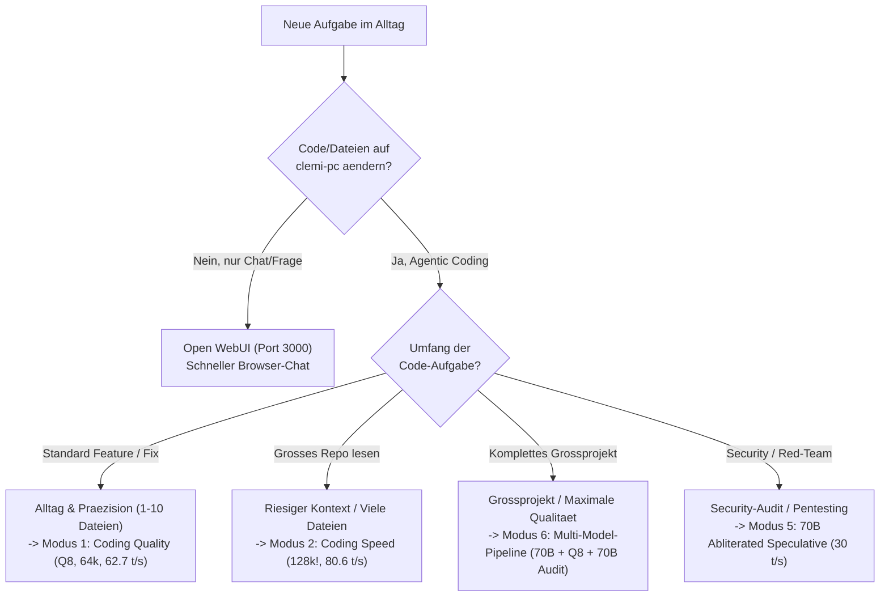

# 🚀 Täglicher Praxis-Guide: Workflows & Tools maximal effizient kombinieren
## Das Zusammenspiel von OpenCode, VS Code, Spracheingabe (`Super+V`), ComfyUI, SearXNG & Remote-Geräten

> **Hardware-Basis:** `clemi-pc` | AMD Radeon PRO W7800 (48 GB GDDR6 VRAM) | 16 Kerne | Ubuntu Linux  
> **Ziel:** In jeder Alltagssituation in **3 Sekunden** das richtige Tool, das richtige Modell und die schnellste Kombination wählen – ohne VRAM-Kollisionen und ohne Zeitverlust.

---

## 🧭 1. Die 3-Sekunden-Entscheidungsmatrix: Was nutze ich wann?

```text
+===================================================================================+
| WAS WILLST DU TUN?                         | BESTE WAHL (TOOL + MODUS)            |
+============================================+======================================+
| 1. Schnelle Wissensfrage, Textentwurf      | 🌐 Open WebUI (Port 3000)            |
|    oder Chat vom Handy ohne Dateizugriff   |    + SearXNG Websuche                |
+--------------------------------------------+--------------------------------------+
| 2. Tägliches Programmieren, Bugfixing,     | 💻 OpenCode -> Modus 1 (Quality 64k) |
|    Skripte schreiben (1 bis 10 Dateien)    |    qwen3-coder-quality (Q8, 62.7 t/s)|
+--------------------------------------------+--------------------------------------+
| 3. Riesiges Repo durchsuchen (20+ Dateien) | ⚡ OpenCode -> Modus 2 (Speed 128k!) |
|    ODER gleichzeitig ComfyUI offen lassen  |    qwen3-coder-speed (80.6 t/s, 24GB)|
+--------------------------------------------+--------------------------------------+
| 4. Schwierige System-Architektur oder      | 👑 OpenCode -> Modus 4 (72B Spec.)   |
|    komplexer Algorithmus-Entwurf           |    qwen2.5-72b-speculative (33.6 t/s)|
+--------------------------------------------+--------------------------------------+
| 5. Neues Großprojekt / komplettes Feature  | 🏆 OpenCode -> Modus 6 (Multi-Model) |
|    mit maximaler Qualität & Vier-Augen     |    70B Plan -> 128k -> Q8 -> 70B Rev.|
+--------------------------------------------+--------------------------------------+
| 6. Security-Audit / Firewall / Docker      | 🔓 OpenCode -> Modus 5 (70B Unzens.) |
|    Pentesting ohne Cloud-Zensurfilter      |    llama3.3-70b-abliterated (30 t/s) |
+--------------------------------------------+--------------------------------------+
| 7. Manuelles Feintuning, Breakpoints &     | 📝 Hybrid: VS Code (--disable-gpu)   |
|    visuelle Side-by-Side Git-Diff-Prüfung  |    + OpenCode unten im Terminal      |
+--------------------------------------------+--------------------------------------+
```



---

## 🔥 2. Die 5 stärksten Tool-Kombinationen (Power-Combos)

Dein System besitzt **5 Säulen** (`agent-cli-setup`, `llm-optimierungen`, `ollama-zugriff`, `spracheingabe-setup`, `image-video-setup`). So kombinierst du sie mit maximaler Synergie:

### Power-Combo 1: „Voice-Driven Agentic Coding“ (`Super+V` Diktat + `OpenCode`)
* **Warum diese Kombi genial ist:**
  Dein lokales Diktier-System (`spracheingabe-setup` mit Whisper STT) läuft zu **100 % auf deiner 16-Kern-CPU (0 MB GPU-VRAM!)**. Deine W7800 hat dadurch volle 48 GB VRAM für das Sprachmodell frei.
* **Ablauf in der Praxis:**
  1. Starte OpenCode im **Modus 1 (`64k Quality`)** oder **Modus 7 (`Tmux 3-Pane Studio`)**.
  2. Statt lange Architektur-Anweisungen mühsam zu tippen: Halte **`Super + V`** gedrückt, sprich deinen Wunsch natürlich ein (*„Slash plan Analysiere die Skripte im Ordner scripts und erstelle einen 3-Punkte-Plan für ein Backup-Modul“*) und lass los.
  3. **Zeitgewinn:** Du diktierst 80 Wörter in 15 Sekunden statt 2 Minuten zu tippen!

---

### Power-Combo 2: „Das Schreibtisch-Cockpit“ (`VS Code --disable-gpu` + `OpenCode CLI` + `Live-Diff`)
* **Warum diese Kombi genial ist:**
  Du bekommst die volle Geschwindigkeit und Kontext-Isolierung der OpenCode-CLI (`@planner`, `@coder`, `@tester`), behältst aber die visuelle Übersicht von VS Code – bei **0 MB GPU-VRAM-Verbrauch** für den Editor.
* **Ablauf in der Praxis:**
  1. Öffne dein Projekt mit deaktivierter Editor-GPU-Beschleunigung:
     ```bash
     code --disable-gpu /home/clemi/Projekte/LLM
     ```
  2. Öffne in VS Code das integrierte Terminal (`Strg + Ö` bzw. `` Ctrl + ` ``) und starte:
     ```bash
     ./agent-cli-setup/scripts/start_agent_session.sh
     ```
  3. Wenn du eine Architektur-Datei oder `PLAN.md` offen hast, drücke in VS Code **`Strg + K` und danach `V`**: Rechts oben siehst du live die gerenderten Mermaid-Diagramme, links oben die farblichen Datei-Diffs und unten steuerst du den Agenten!

---

### Power-Combo 3: „Full-Stack Autonomous Loop“ (`SearXNG` ➔ `@coder` ➔ `Playwright` ➔ `@reviewer`)
* **Warum diese Kombi genial ist:**
  Der Agent recherchiert aktuelle Fakten selbst, schreibt den Code isoliert im Worktree, testet die fertige Webseite/API im echten Chromium-Browser und prüft sich selbst auf Sicherheitslücken.
* **Die 4 Befehle hintereinander in OpenCode:**
  ```text
  1. /suche FastAPI WebSocket reconnect pattern python 2026
  2. @coder Implementiere den WebSocket-Endpunkt im Coding-Worktree basierend auf den Suchergebnissen.
  3. /webtest http://127.0.0.1:8000
  4. /review agent-cli-setup/projects/worktrees/coding/
  ```

---

### Power-Combo 4: „KI-Medien + Coding im Wechsel“ (`ComfyUI` + `OpenCode Modus 2 / Flush`)
* **Warum diese Kombi genial ist:**
  Wenn du in `image-video-setup` an Prompts, Python-Automatisierungsskripten (`run_flux2_ref2i.py`) oder Drehbüchern arbeitest, willst du schnell zwischen Coding-Agent und Bild/Video-Generierung wechseln:
  - **Leichter Parallelbetrieb:** Nutze **Modus 2 (`qwen3-coder-speed`)** – dieser lässt über **20 GB VRAM frei**.
  - **Vor schweren Flux2- oder Wan2.1-Video-Renders:** Wähle im Launcher einfach **Taste `0` (`VRAM-Flush`)** oder führe `./agent-cli-setup/scripts/free_agent_vram.sh --all` aus – in 1 Sekunde sind alle 48 GB VRAM wieder zu 100 % frei für ComfyUI!

---

### Power-Combo 5: „Nahtloser Geräte-Staffellauf“ (`PC` ➔ `Android-Handy` ➔ `Laptop`)
* **Warum diese Kombi genial ist:**
  Du bist bei langen Multi-Model-Läufen nicht an deinen Schreibtisch gefesselt.
* **Ablauf:**
  1. **Am PC (oder Laptop per SSH):** Starte deine Sitzung über `remote_agent.sh tmux` (oder nutze den automatischen Webserver auf `Port 4096`).
  2. **Unterwegs am Android-Handy:** Tippe auf dein **OpenCode-Homescreen-Icon (`http://100.x.y.z:4096`)** oder das **ConnectBot-Widget** – du siehst sofort, ob `@coder` fertig ist, und kannst mit einem Fingertipp den nächsten Schritt freigeben.

---

## ⏱️ 3. Dein optimaler Tages-Workflow (Schritt für Schritt)

### 🌅 Schritt 1: Morgen-Start (1 Befehl)
Öffne ein Terminal (oder VS Code mit `code --disable-gpu`) und starte das Cockpit:
```bash
cd /home/clemi/Projekte/LLM/agent-cli-setup
./scripts/start_agent_session.sh
```
* **Für 90 % aller Tage:** Drücke **`1`** (*Coding Quality 64k*) oder direkt **`7`** (*3-Pane Tmux Sidecar-Cockpit* mit Live-GPU & Live-Git-Diff).
* **Für lange Sessions im Sommer / bei großen Prompts:** Einmalig vorher Taste **`9` -> `1` (`230W Performance + 65% Lüfter`)** aktivieren (+18 % schnellerer Prefill, Hotspot 24 °C kühler).

---

### 🛠️ Schritt 2: Der goldene 4-Takt-Rhythmus für jedes Feature
Gewöhne dir in OpenCode diesen kurzen Rhythmus an – damit arbeitest du schneller und fehlerfreier als mit jedem Cloud-Tool:

1. **Takt 1 — Planen (Read-Only):**
   ```text
   /plan Analysiere <Ordner/Datei> und erstelle einen 3-Punkte-Plan für <Dein Ziel>.
   ```
   *(Oder bei Großprojekten in `PLAN.md` schreiben lassen).*
2. **Takt 2 — Umsetzen (`@coder`):**
   ```text
   @coder Setze Punkt 1 und 2 des Plans direkt um.
   ```
   *(Du prüfst das angezeigte Diff und bestätigst mit Enter).*
3. **Takt 3 — Testen & Prüfen (`/webtest` & `/review`):**
   ```text
   /review <Geänderte Datei>
   ```
   *(Gefällt dir etwas nicht? Einfach `/undo` tippen!).*
4. **Takt 4 — Kontext erfrischen (`/compact`):**
   ```text
   /compact
   ```
   *(Hält den KV-Cache klein und sorgt dafür, dass auch die nächste Antwort wieder sofort mit >60 t/s startet!).*

---

### 🌙 Schritt 3: Feierabend-Check (Alles sauber & gesichert?)
Bevor du den Arbeitsplatz verlässt (oder wenn du auf ComfyUI wechselst):
```bash
# 1. Alle Änderungen im jeweiligen Projekt-Repo committen & pushen:
git status -sb
git add -A && git commit -m "feat: tagesfortschritt" && git push

# 2. Optional: VRAM für den Ruhemodus (oder ComfyUI) freigeben & Lüfter auf Silent (200W) stellen:
/home/clemi/Projekte/LLM/agent-cli-setup/scripts/free_agent_vram.sh --all
/home/clemi/Projekte/LLM/scripts/set-gpu-mode-daily.sh
```

---

## 💡 4. Die Top-7 Effizienz-Regeln auf einen Blick

1. **Sprich statt zu tippen (`Super+V`):** Für komplexe Kontext-Erklärungen an `@planner` ist Spracheingabe 4x schneller als die Tastatur.
2. **Nutze `@dateiname` im Prompt:** Wenn du schon weißt, um welche Datei es geht, tippe `@` + Dateiname – das spart dem Agenten 2–3 Such-Turns (`glob`/`grep`).
3. **Wähle Modus 2 (`128k Speed`) für große Lese-Aufgaben:** Wenn der Agent 15 Dateien gleichzeitig vergleichen soll, ist `qwen3-coder-speed` (`128k` Kontext, `80,6 t/s`) unschlagbar.
4. **Wähle Modus 6 (`Multi-Model`) für kritische Architektur & Security:** Ein 70B-Llama-Modell findet im `/review` Fehler, die ein Qwen-Modell im eigenen Code übersieht.
5. **Tippe `/compact` nach jedem abgeschlossenen Teilziel:** Ein schlanker Kontext (unter 15k Tokens) antwortet in 1 Sekunde; ein voller Kontext (60k+ Tokens) braucht mehrere Sekunden Prefill-Zeit.
6. **Nutze `/undo` statt langer Korrektur-Diskussionen:** Wenn ein Edit des Agenten in die falsche Richtung läuft, diskutiere nicht 5 Runden mit ihm – tippe `/undo` und präzisiere deinen Prompt in einem Satz.
7. **Starte VS Code lokal immer mit `code --disable-gpu`:** So gehören 100 % deiner 48 GB W7800-VRAM deiner KI!

