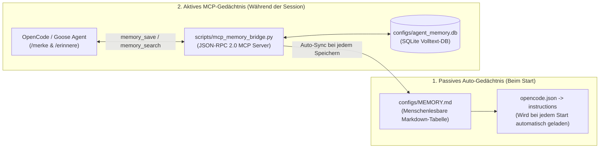

# 🧠 10. Lokales Agenten-Gedächtnis & Empfohlene Default-Konfiguration

> **Ziel:** Ein sitzungsübergreifendes, deterministisches Langzeit-Gedächtnis für `OpenCode` und `Goose` mit **0 MB VRAM-Verbrauch** (damit das aktive 35B/70B/72B-Modell niemals entladen wird) sowie klare Default-Konfigurationsprofile für deinen Arbeitsalltag auf `clemi-pc`.

---

## 🏛️ 1. Wie funktioniert dein lokales Dual-Gedächtnis?

Dein Agenten-Gedächtnis kombiniert **zwei sich ergänzende Schichten**:



1. **Schicht 1 — Passives Auto-Gedächtnis (`instructions` in [`configs/opencode.json`](file:///home/clemi/Projekte/LLM/agent-cli-setup/configs/opencode.json#L5-L7)):**
   Durch den Eintrag `"instructions": ["/home/clemi/Projekte/LLM/agent-cli-setup/configs/MEMORY.md"]` liest OpenCode deine [`configs/MEMORY.md`](file:///home/clemi/Projekte/LLM/agent-cli-setup/configs/MEMORY.md) bei **jedem Session-Start automatisch** in den System-Kontext ein. Der Agent kennt deine Hardware, Ports und Konventionen sofort ab der ersten Sekunde – ohne einen einzigen Tool-Aufruf!
2. **Schicht 2 — Aktives Schreib-/Such-Gedächtnis (`local-memory` MCP in [`scripts/mcp_memory_bridge.py`](file:///home/clemi/Projekte/LLM/agent-cli-setup/scripts/mcp_memory_bridge.py)):**
   Wenn du im Chat `/merke ...` eingibst oder dem Agenten sagst *„Merke dir diese Architekturentscheidung"*, speichert er den Fakt über das MCP-Tool `memory_save` in der SQLite-Datenbank [`configs/agent_memory.db`](file:///home/clemi/Projekte/LLM/agent-cli-setup/configs/agent_memory.db) **und** aktualisiert gleichzeitig automatisch [`configs/MEMORY.md`](file:///home/clemi/Projekte/LLM/agent-cli-setup/configs/MEMORY.md).

---

## 🛠️ 2. Umgang mit dem Gedächtnis im Alltag (Befehle & Workflows)

### A. Direkt im OpenCode Chat (`opencode`)

| Befehl im Chat | Was passiert? | Praxis-Beispiel |
| :--- | :--- | :--- |
| **`/merke <Fakt>`** | Speichert oder aktualisiert einen Fakt dauerhaft in SQLite + `MEMORY.md`. | `/merke Für das Dashboard-Projekt nutzen wir FastAPI auf Port 8095 und SQLite im WAL-Modus.` |
| **`/erinnere <Begriff>`** | Durchsucht das Langzeit-Gedächtnis gezielt nach einem Stichwort oder Projekt. | `/erinnere Port` oder `/erinnere FastAPI` |
| **`/erinnere`** *(ohne Text)* | Listet alle gespeicherten Einträge aus dem Gedächtnis auf. | `/erinnere` |
| **Natürliche Sprache** | Du kannst jederzeit auch ohne Slash-Command mit dem Gedächtnis sprechen. | *„Speichere diesen Bugfix mit `memory_save` unter dem Key `rocm-flash-attn-fix`."* |

---

### B. Über das Linux-Terminal ([`scripts/memory.sh`](file:///home/clemi/Projekte/LLM/agent-cli-setup/scripts/memory.sh))

Du kannst das Gedächtnis jederzeit auch außerhalb von OpenCode direkt im Terminal verwalten:

```bash
# 1. Alle gespeicherten Erinnerungen übersichtlich auflisten:
/home/clemi/Projekte/LLM/scripts/memory.sh list

# 2. Neuen Fakt per Terminal hinzufügen (oder bestehenden Schlüssel überschreiben):
/home/clemi/Projekte/LLM/scripts/memory.sh add "api-port-projekt-x" "Projekt X läuft auf Port 8095 mit Pydantic v2" --category architektur --project projekt-x

# 3. Volltextsuche über Schlüssel, Kategorien, Projekte und Inhalte:
/home/clemi/Projekte/LLM/scripts/memory.sh search "Port"

# 4. Veralteten Eintrag gezielt löschen:
/home/clemi/Projekte/LLM/scripts/memory.sh delete "api-port-projekt-x"

# 5. Die 10 Goldenen Standard-Systemregeln jederzeit wiederherstellen:
/home/clemi/Projekte/LLM/scripts/memory.sh reset-defaults
```

---

### C. Visuelle Kontrolle im Browser (Sidecar 7 auf Port `4097`)

Wenn du das Dokumentations-Sidecar aktivierst (`./scripts/sidecar_manager.sh 7 on`), findest du links in der Seitenleiste unter **`http://100.x.y.z:4097`** den Punkt **`🧠 MEMORY.md (Langzeit-Gedächtnis)`** und siehst live jede neue Erinnerung, die der Agent speichert.

---

### D. 4 Goldene Regeln für „Gedächtnis-Hygiene" (damit der Kontext schnell bleibt)

Da `MEMORY.md` automatisch beim Start gelesen wird, solltest du das Gedächtnis sauber halten:
1. **Fakten statt Chat-Protokolle speichern:** Speichere kurze, präzise Regeln (1–2 Sätze pro Eintrag, z. B. Ports, Pfade, Architektur-Entscheidungen, wiederholte Bug-Ursachen), keine seitenlangen Code-Blöcke.
2. **Eindeutige Schlüssel (`key`) zum Überschreiben nutzen:** Wenn sich ein Port oder eine Regel ändert, nutze denselben `key` (z. B. `port-architektur`) – `memory_save` überschreibt den alten Stand automatisch (`INSERT OR REPLACE`), statt Duplikate anzulegen.
3. **Kategorien nutzen:** Halte dich an klare Kategorien:
   * `system` (Hardware, Treiber, Pfade)
   * `architektur` (Modi, Ports, Datenbank-Design)
   * `konvention` (Git-Hooks, 4-Säulen-Standard, Namensregeln)
   * `workflow` (Worktrees, Sidecars, Test-Abläufe)
   * `praferenz` (Sprache, Code-Stil, Frameworks)
   * `bugfix` (Wichtige Erkenntnisse aus gelösten Fehlern)
4. **Richtwert:** Halte die Kern-Tabelle bei **10 bis maximal 40 Einträgen** (~1.000–2.500 Tokens). Damit verbraucht dein gesamtes Langzeit-Gedächtnis weniger als **2–3 %** deines `64k`/`128k` Kontextfensters!

---

## ⚙️ 3. Vorschläge für eine optimale Default-Konfiguration

Je nachdem, wie du hauptsächlich arbeitest, empfehlen sich **3 abgestimmte Default-Profile**. **Profil A** ist bereits als dein Standard in [`configs/opencode.json`](file:///home/clemi/Projekte/LLM/agent-cli-setup/configs/opencode.json) und [`configs/MEMORY.md`](file:///home/clemi/Projekte/LLM/agent-cli-setup/configs/MEMORY.md) voreingestellt:

### 🏆 Profil A: „Daily Driver Balanced" *(Aktueller Standard — Beste Wahl für 90 % aller Aufgaben)*

Dieses Profil bietet das beste Verhältnis aus **Q8-Code-Präzision (62,7 t/s)**, **64k Kontext**, **0s Modell-Wechselzeit** und voller Sicherheit:

| Einstellung | Empfohlener Default-Wert | Begründung |
| :--- | :--- | :--- |
| **Haupt- & Subagent-Modell** | `ollama/qwen3-coder-quality` *(Modus `1`)* | Höchste Coding-Qualität (`Q8_0`), **62,7 t/s**, **0x VRAM-Reload** bei `@planner`/`@coder`/`@tester`/`@reviewer`. |
| **Default-Kontextfenster** | **`65.536` (`64k`)** | Nutzt ~35,5 GB deiner 48 GB VRAM optimal aus, ohne in die 41-GiB-Hotspot-Grenze zu laufen. |
| **Auto-Gedächtnis (`instructions`)** | `[".../configs/MEMORY.md"]` | Lädt die 10 Goldenen Systemregeln automatisch beim Start (0 Tool-Calls nötig). |
| **Berechtigungen (`permission`)** | `edit: "ask"`, `bash: "ask"`, `webfetch: "deny"` | 100 % Schutz vor ungewollten Dateiänderungen und Zero-Data-Egress ins Internet. |
| **Aktive MCP-Server** | `local-memory` + `local-searxng` + `playwright` (headless) | Alle 3 MCP-Server verbrauchen im Leerlauf **0 MB VRAM** und starten in <0,2 s. |
| **Standard-Sidecars** | Sidecar `1` (`gpu`) + Sidecar `2` (`git`) | Über Modus `7` (`Tmux Split-Studio`) sofort im Blick. |
| **GPU-Power-Profil** | `200W Daily Silent` *(oder `230W` bei Dauerlast)* | Leise im Alltag; bei langen Sessions kurzer Wechsel auf `230W / 65% Lüfter`. |

---

### ⚡ Profil B: „High-Speed & Monorepo 128k" *(Für riesige Codebasen & schnelle Iteration)*

Wenn du sehr große Repositories auf einmal durchsuchen oder in maximaler Geschwindigkeit (**80,6 t/s**) entwickeln willst:
* **Start:** `./scripts/start_agent_session.sh` -> **Taste `2` (`Coding Speed 128k`)**
* **Modell:** `ollama/qwen3-coder-speed` (`Q4_K_M`, **131.072 Tokens / 128k Kontext** bei nur ~24,5 GB VRAM)
* **Optional für Hands-Free-Coding im isolierten Worktree:**
  Wenn du ausschließlich im isolierten `projects/worktrees/coding/` arbeitest und nicht jede Dateiänderung einzeln bestätigen möchtest, kannst du in `configs/opencode.json` temporär `"edit": "allow"` setzen (während `"bash": "ask"` und `"webfetch": "deny"` als Sicherheitsnetz aktiv bleiben).

---

### 👑 Profil C: „Deep Architecture & 72B Speculative" *(Für schwierigste System- & Security-Entscheidungen)*

Wenn maximale logische Tiefe (70B/72B Dense-Modelle) gefragt ist:
* **Start:** `./scripts/start_agent_session.sh` -> **Taste `4` (`72B Flaggschiff 32k`)** oder **Taste `6` (`Multi-Model Großprojekt-Workflow`)**
* **Empfohlene Sidecars dazu:**
  ```bash
  ./scripts/sidecar_manager.sh 4 on   # Zeigt live die Speculative-Decoding Speed & Draft-Rate auf Port 5002
  ./scripts/sidecar_manager.sh 7 on   # Zeigt live PLAN.md & Architektur-Diagramme auf Port 4097
  ```

---

## 📋 4. Deine 10 vorinstallierten Default-Gedächtnisregeln (`MEMORY.md`)

Diese 10 Regeln sind als Basis-Konfiguration fest in [`configs/MEMORY.md`](file:///home/clemi/Projekte/LLM/agent-cli-setup/configs/MEMORY.md) und [`configs/agent_memory.db`](file:///home/clemi/Projekte/LLM/agent-cli-setup/configs/agent_memory.db) hinterlegt (jederzeit wiederherstellbar mit `./scripts/memory.sh reset-defaults`):

1. **`hardware-w7800` (`system`):** AMD Radeon PRO W7800 mit 48 GB GDDR6 VRAM (Netto ~44,4 GiB, Sicherheitsgrenze <= 41 GiB VRAM). ROCm 6.4 nativ, 128 GB System-RAM.
2. **`4-saeulen-standard` (`konvention`):** Alle Projekte im LLM-Workspace nutzen strikt den 4-Säulen-NAS-Standard: `configs/`, `docs/`, `scripts/`, `setup/` + `README.md`.
3. **`single-model-regel` (`architektur`):** In Single-Model-Modi (`1`–`5`) nutzen Hauptagent, `small_model` und Subagents exakt dasselbe Modell für 0x VRAM-Reload.
4. **`kontext-matrix` (`architektur`):** Maximierte 100%-VRAM Default-Kontexte: Modus 1 (`qwen3-coder-quality` Q8) = `64k` | Modus 2 (`qwen3-coder-speed` Q4) = `128k` | Modus 3 (`qwen3.8-35b-distill` Q6) = `96k` | Modus 4/5 (`70B/72B Speculative`) = `32k`.
5. **`port-architektur` (`netzwerk`):** Port `11434`: Ollama | Port `5002`: `llama-speedup` | Port `8081`: SearXNG | Port `8000`: Whisper STT | Port `4096`: OpenCode Web | Port `4097`: Mermaid Sidecar | Port `8090`: App-Preview.
6. **`netzwerk-sicherheit` (`sicherheit`):** Tailscale Mesh IP: `100.x.y.z`. Kein direkter Internet-Zugriff durch Agenten (`webfetch: deny`); Websuche ausschließlich anonym über lokales SearXNG.
7. **`git-hooks-konvention` (`konvention`):** Git-Commits folgen strikt Conventional Commits (`feat:`, `fix:`, `docs:`, `chore:`, `refactor:`, max. 72 Zeichen). Keine `*.gguf`/`*.bin` Dateien oder Dateien > 2 MB committen.
8. **`worktree-isolation` (`workflow`):** Isolierte Git-Worktrees unter `projects/worktrees/`: `coding/` (`agent/coding`), `testing/` (`agent/testing`), `review/` (`agent/review`).
9. **`code-qualitaet` (`praferenz`):** Sprache für Dokumentation und Erklärungen: Deutsch. Shell-Skripte mit `set -eo pipefail`, Python-Skripte mit Typannotationen und möglichst ohne unnötige externe Abhängigkeiten.
10. **`sidecar-steuerung` (`workflow`):** Alle 8 Sidecars (`1:gpu`, `2:git`, `3:test`, `4:speed`, `5:browser`, `6:plan`, `7:docs`, `8:app`) werden über `./scripts/sidecar_manager.sh <1..8> {on|off|toggle}` gesteuert.

