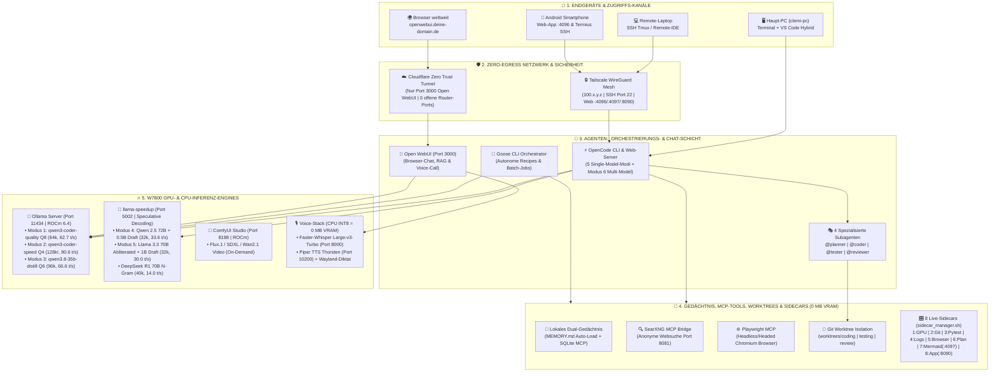
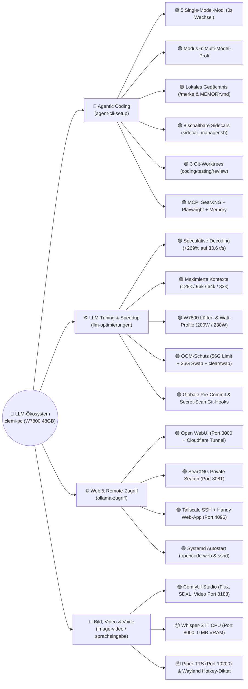
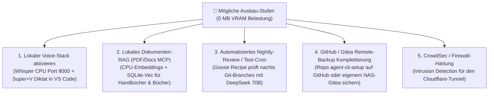

# 🗺️ Grafische System-Landkarte & Tool-Matrix (`clemi-pc` KI-Ökosystem)

> **Hardware-Basis:** AMD Radeon PRO W7800 (48 GB GDDR6 VRAM, Netto ~44,4 GiB, Sicherheitsgrenze $\le$ 41 GiB) | 16 Kerne | 128 GB RAM | 36 GB NVMe-Swap | Ubuntu Linux (ROCm 6.4 nativ)  
> **Zweck dieses Dokuments:** Zentrale, grafische Gesamtübersicht über **alle bereits live umgesetzten Tools (`🟢 LIVE`)**, **installierten On-Demand-Module (`📦 BEREIT`)** und **möglichen zukünftigen Erweiterungen (`🔮 MÖGLICH`)** im gesamten `/home/clemi/Projekte/LLM`-Ökosystem.

---

## 🏛️ 1. Grafische Gesamt-Architektur (Alle Schichten im Zusammenspiel)



---

## 🔄 2. Visuelle Funktions-Landkarte (Mindmap aller Module)



---

## 📊 3. Komplette Status-Matrix: Umgesetzte vs. Vorbereitete vs. Mögliche Funktionen

> **Legende:**  
> * 🟢 **LIVE & UMGESETZT:** Komplett installiert, konfiguriert, getestet und sofort einsatzbereit.  
> * 📦 **VORBEREITET (ON-DEMAND):** Skripte/Docker-Compose liegen fertig im Repo, wird nur bei Bedarf gestartet (verbraucht im Standby 0 Ressourcen).  
> * 🔮 **MÖGLICH (AUSBAU-OPTION):** Noch nicht installiert – sinnvolle zukünftige Erweiterung mit direktem Mehrwert.

---

### Säule A: Agenten, Modi & Workflows ([`agent-cli-setup/`](file:///home/clemi/Projekte/LLM/agent-cli-setup/README.md))

| Tool / Funktion | Status | Kurzbeschreibung & Leistung | Startbefehl / Ort |
| :--- | :---: | :--- | :--- |
| **Modus 1: Coding Quality (`64k`)** | 🟢 **LIVE** | `qwen3-coder-quality` (`Q8_0`), **62,7 t/s**, `64k` Kontext, `0x` Entladen | `./scripts/start_agent_session.sh` -> `1` |
| **Modus 2: Coding Speed (`128k!`)** | 🟢 **LIVE** | `qwen3-coder-speed` (`Q4_K_M`), **80,6 t/s**, **`128k` Ultra-Kontext** | `./scripts/start_agent_session.sh` -> `2` |
| **Modus 3: Allround Distill (`96k`)** | 🟢 **LIVE** | `qwen3.8-35b-distill` (`Q6_K`), **66,6 t/s**, **`96k` Kontext** | `./scripts/start_agent_session.sh` -> `3` |
| **Modus 4: 72B Flaggschiff (`32k`)** | 🟢 **LIVE** | `qwen2.5-72b-speculative` (Port 5002), **33,6 t/s** (+269% Speedup) | `./scripts/start_agent_session.sh` -> `4` |
| **Modus 5: 70B Unzensiert (`32k`)** | 🟢 **LIVE** | `llama3.3-70b-abliterated-speculative`, **30,0 t/s**, Security/Red-Team | `./scripts/start_agent_session.sh` -> `5` |
| **Modus 6: Multi-Model-Profi** | 🟢 **LIVE** | `@planner`=70B, Hauptagent=128k Speed, `@coder`=Q8, `@reviewer`=70B | `./scripts/multimodel_project_workflow.sh` |
| **Vollautomatische 4-Stufen-Pipeline** | 🟢 **LIVE** | Führt Plan (70B) -> Code (Q8) -> Test (Speed) -> Review (70B) in Reihe aus | `./scripts/multimodel_project_workflow.sh pipeline "..."` |
| **Isolierte Git-Worktrees** | 🟢 **LIVE** | Getrennte Ordner `coding/`, `testing/`, `review/` gegen Datei-Konflikte | `./agent-cli-setup/scripts/setup_worktrees.sh` |
| **Goose CLI Orchestrator** | 🟢 **LIVE** | Zweite Agenten-Runtime für automatisierte Recipes (`goose-config.yaml`) | `./scripts/start_agent_session.sh` -> `8` |
| **Next-80B Architekten-Profil** | 📦 **BEREIT** | Schaltet `@planner` & `@reviewer` auf `qwen3-next-80b` (80B MoE) um | `./scripts/multimodel_project_workflow.sh enable-next80b` |

---

### Säule B: Lokales Gedächtnis & MCP-Werkzeuge (`0 MB VRAM`)

| Tool / Funktion | Status | Kurzbeschreibung & Nutzen | Befehl im Chat / Terminal |
| :--- | :---: | :--- | :--- |
| **Passives Auto-Gedächtnis (`MEMORY.md`)** | 🟢 **LIVE** | Lädt die 10 Goldenen Systemregeln automatisch bei jedem OpenCode-Start | Automatisch via [`configs/opencode.json`](file:///home/clemi/Projekte/LLM/agent-cli-setup/configs/opencode.json) |
| **Aktives MCP-Gedächtnis (`local-memory`)** | 🟢 **LIVE** | Speichert & durchsucht Fakten persistent in SQLite (`agent_memory.db`) + Markdown | Chat: `/merke ...` & `/erinnere ...`<br/>CLI: [`./scripts/memory.sh`](file:///home/clemi/Projekte/LLM/scripts/memory.sh) |
| **Private Websuche (`local-searxng` MCP)** | 🟢 **LIVE** | Anonyme Echtzeit-Websuche über deinen lokalen SearXNG-Container (`Port 8081`) | Chat: `/suche ...`<br/>CLI: [`./scripts/suche.sh "..."`](file:///home/clemi/Projekte/LLM/scripts/suche.sh) |
| **Browser-Automation (`playwright` MCP)** | 🟢 **LIVE** | Steuert echtes Chromium zum Prüfen von Web-UIs, DOM & Formularen | Chat: `/webtest http://...` |
| **CPU-Vektor-RAG / Dokumenten-Index** | 🔮 **MÖGLICH** | Lokale PDF-/Buch-Suche über `fastembed` (CPU) + SQLite-Vec ohne GPU-Reload | *Bei Bedarf als MCP-Modul ergänzbar* |
| **Datenbank-MCP (`sqlite` / `postgres`)** | 🔮 **MÖGLICH** | Direkter Read/Write-SQL-Zugriff für Agenten auf externe Projekt-Datenbanken | *Bei Bedarf in `opencode.json` aktivierbar* |

---

### Säule C: Die 8 Begleit-Sidecars ([`scripts/sidecar_manager.sh`](file:///home/clemi/Projekte/LLM/agent-cli-setup/scripts/sidecar_manager.sh))

Alle 8 Sidecars sind **🟢 LIVE** implementiert und lassen sich einzeln mit `./scripts/sidecar_manager.sh <1..8> {on|off|toggle}` schalten:

```text
+---------------------------------------------------------------------------------------------------+
| 🎛️ SIDECAR-COCKPIT (Steuerung via ./scripts/sidecar_manager.sh oder Taste 's' im Startmenü)       |
+-------------------+-----------------------------------+-------------------------------------------+
| 1) 🌡️ gpu         | W7800 VRAM, Hotspot & Watt        | Tmux-Pane (@SC1_GPU)   | 0 MB VRAM        |
| 2) 🌳 git         | Live Git-Diff & Worktree-Radar    | Tmux-Pane (@SC2_GIT)   | 0 MB VRAM        |
| 3) 🧪 test        | Kontinuierlicher TDD-Pytest-Lauf  | Tmux-Pane (@SC3_TEST)  | 0 MB VRAM        |
| 4) 🚀 speed       | Token/s & Speculative-Logs (5002) | Tmux-Pane (@SC4_SPEED) | 0 MB VRAM        |
| 5) 🌐 browser     | Sichtbares Chromium-Fenster       | Headed-Toggle in JSON  | ~150 MB RAM      |
| 6) 📋 plan        | Live PLAN.md Checklisten-Tracker  | Tmux-Pane (@SC6_PLAN)  | 0 MB VRAM        |
| 7) 📊 docs        | Live Mermaid.js & MEMORY.md Web   | Port 4097 (Dark-Mode)  | 0 MB VRAM        |
| 8) 🔬 app         | Live Coding-Worktree Web-Preview  | Port 8090 (HTTP)       | 0 MB VRAM        |
+-------------------+-----------------------------------+-------------------------------------------+
```

---

### Säule D: Hardware-Tuning, Sicherheit & Multimedia ([`llm-optimierungen/`](file:///home/clemi/Projekte/LLM/llm-optimierungen/README.md), [`image-video-setup/`](file:///home/clemi/Projekte/LLM/image-video-setup/README.md))

| Tool / Funktion | Status | Kurzbeschreibung & Nutzen | Startbefehl / Skript |
| :--- | :---: | :--- | :--- |
| **W7800 230W Performance-Boost** | 🟢 **LIVE** | Hebt Power-Limit auf 230W + Lüfter auf 65% (**-24 °C GPU-Hotspot!**) | [`./scripts/set-gpu-mode-performance.sh`](file:///home/clemi/Projekte/LLM/scripts/set-gpu-mode-performance.sh) |
| **W7800 200W Daily-Silent-Modus** | 🟢 **LIVE** | Flüsterleiser Alltagsbetrieb mit automatischer Lüfterkurve | [`./scripts/set-gpu-mode-daily.sh`](file:///home/clemi/Projekte/LLM/scripts/set-gpu-mode-daily.sh) |
| **Gezielter VRAM-Flush** | 🟢 **LIVE** | Entlädt wahlweise nur Ollama, nur Port 5002 oder alle GPU-Prozesse | [`./agent-cli-setup/scripts/free_agent_vram.sh`](file:///home/clemi/Projekte/LLM/agent-cli-setup/scripts/free_agent_vram.sh) |
| **ROCm-sicheres Swap-Management** | 🟢 **LIVE** | 36 GB NVMe-Swap + `sudo clearswap` ohne ROCm-Speicher-Deadlock | `sudo clearswap` |
| **Globale Git-Sicherheits-Hooks** | 🟢 **LIVE** | Blockiert GGUF/Großdateien (>2 MB), geleakte Keys & prüft Commit-Format | [`./llm-optimierungen/scripts/setup-global-hooks.sh`](file:///home/clemi/Projekte/LLM/llm-optimierungen/scripts/setup-global-hooks.sh) |
| **Remote-Zugriff (Handy & Laptop)** | 🟢 **LIVE** | Persistenter SSH-Server (`Port 22`) + OpenCode Web-App (`Port 4096`) via Tailscale | [`./agent-cli-setup/scripts/remote_agent.sh`](file:///home/clemi/Projekte/LLM/agent-cli-setup/scripts/remote_agent.sh) |
| **ComfyUI Bild- & Video-Studio** | 🟢 **LIVE** | Lokale Bild-/Videogenerierung auf Port `8188` (ROCm nativ) | [`./image-video-setup/scripts/start_comfyui.sh`](file:///home/clemi/Projekte/LLM/image-video-setup/scripts/start_comfyui.sh) |
| **Lokaler Voice-Stack (Whisper + Piper)** | 📦 **BEREIT** | CPU-Spracheingabe (`Port 8000`, **0 MB VRAM**) + Sprachausgabe (`Port 10200`) + Wayland-Diktat | [`llm-optimierungen/spracheingabe-setup/`](file:///home/clemi/Projekte/LLM/llm-optimierungen/spracheingabe-setup/README.md) |

---

## 🔮 4. Roadmap: Welche möglichen Erweiterungen lohnen sich als Nächstes?

Wenn du dein System in Zukunft noch weiter ausbauen möchtest, sind diese **5 Erweiterungen** am besten für deine Architektur geeignet (alle mit **0 MB zusätzlichem GPU-VRAM** machbar!):



| Rang | Mögliche Funktion | Aufwand | Nutzen im Alltag |
| :---: | :--- | :---: | :--- |
| **1** | **🎙️ Voice-Stack live starten (`whisper-stt` + `Super+V`)** | **2 Min.** *(schon fertig im Repo!)* | Lange Architektur-Prompts in VS Code oder Terminal einfach per Mikrofon einsprechen (0 MB VRAM, da CPU INT8). |
| **2** | **📚 Lokales PDF- & Code-Wissensdatenbank-MCP (CPU-RAG)** | ~15 Min. | Eigene Fachbücher, PDFs und API-Spezifikationen lokal indizieren und per `/wissen <Frage>` durchsuchen (auf CPU, ohne Modell-Entladen). |
| **3** | **🌙 Nächtlicher Qualitäts- & Security-Lauf (Goose Cron)** | ~10 Min. | Ein Goose-Recipe lässt nachts um 03:00 Uhr `deepseek-r1-70b` oder `qwen2.5-72b` über neue Commits laufen und legt morgens einen Audit-Bericht in Sidecar 7 (`Port 4097`) ab. |
| **4** | **☁️ GitHub / NAS-Git-Sync für `agent-cli-setup`** | **1 Min.** | Sobald das leere Repo `globalx-prog/agent-cli-setup` auf GitHub angelegt ist: `git push -u origin main`. |
| **5** | **🐳 Sandbox-Container für Code-Ausführung (`Docker-Exec MCP`)** | ~15 Min. | Lässt `@tester` riskante oder unbekannte Skripte in einem Wegwerf-Docker-Container statt direkt auf dem Host ausführen. |

---

## 🌐 5. Zentrale Port- & Adress-Übersicht auf `clemi-pc`

| Port | Dienst / Funktion | Lokal (`clemi-pc`) | Tailscale (`Laptop / Handy`) | Öffentlich (`Cloudflare`) |
| :---: | :--- | :--- | :--- | :---: |
| **`11434`** | **Ollama GPU-Server** *(Modi 1–3)* | `http://127.0.0.1:11434` | `http://100.x.y.z:11434` | ❌ Blockiert |
| **`5002`** | **llama-speedup** *(Speculative 70B/72B, Modi 4–5)* | `http://127.0.0.1:5002` | `http://100.x.y.z:5002` *(bei Bedarf)* | ❌ Blockiert |
| **`4096`** | **OpenCode Web-UI** *(Touch-App für Handy/Browser)* | `http://127.0.0.1:4096` | **`http://100.x.y.z:4096`** | ❌ Blockiert |
| **`4097`** | **Sidecar 7: Live Mermaid, `PLAN.md` & `MEMORY.md`** | `http://127.0.0.1:4097` | **`http://100.x.y.z:4097`** | ❌ Blockiert |
| **`8090`** | **Sidecar 8: Live Worktree App-Preview** | `http://127.0.0.1:8090` | **`http://100.x.y.z:8090`** | ❌ Blockiert |
| **`8081`** | **SearXNG Private Websuche** *(MCP & Browser)* | `http://127.0.0.1:8081` | `http://100.x.y.z:8081` | ❌ Blockiert |
| **`8000`** | **Whisper STT Audio-API** *(CPU, On-Demand)* | `http://127.0.0.1:8000` | Intern (`ai-network`) | ❌ Blockiert |
| **`8188`** | **ComfyUI Studio** *(Bild & Video, On-Demand)* | `http://127.0.0.1:8188` | `http://100.x.y.z:8188` | ❌ Blockiert |
| **`3000`** | **Open WebUI** *(Browser-Chat)* | `http://127.0.0.1:3000` | `http://100.x.y.z:3000` | ✅ `openwebui.deine-domain.de` |
| **`22`** | **OpenSSH Server** *(Terminal, Termius & VS Code Remote)* | `localhost:22` | **`clemi@100.x.y.z:22`** | ❌ Blockiert |

---

## ⚡ 6. Die wichtigsten Befehle auf einen Blick

```bash
# 1. Haupt-Cockpit starten (Modi 1-6, Tmux-Studio, Sidecars, GPU-Power, VRAM-Flush):
/home/clemi/Projekte/LLM/agent-cli-setup/scripts/start_agent_session.sh

# 2. Alle 8 Sidecars verwalten (Interaktives Menü oder Direktbefehl):
/home/clemi/Projekte/LLM/scripts/sidecar_manager.sh
/home/clemi/Projekte/LLM/scripts/sidecar_manager.sh status
/home/clemi/Projekte/LLM/scripts/sidecar_manager.sh all-on

# 3. Lokales Langzeit-Gedächtnis verwalten (oder im Chat: /merke & /erinnere):
/home/clemi/Projekte/LLM/scripts/memory.sh list

# 4. Private Websuche direkt im Terminal (oder im Chat: /suche):
/home/clemi/Projekte/LLM/scripts/suche.sh "Suchbegriff"

# 5. Kompletten System-, GPU-, Temperatur- & Port-Status prüfen:
/home/clemi/Projekte/LLM/agent-cli-setup/scripts/status.sh
```

