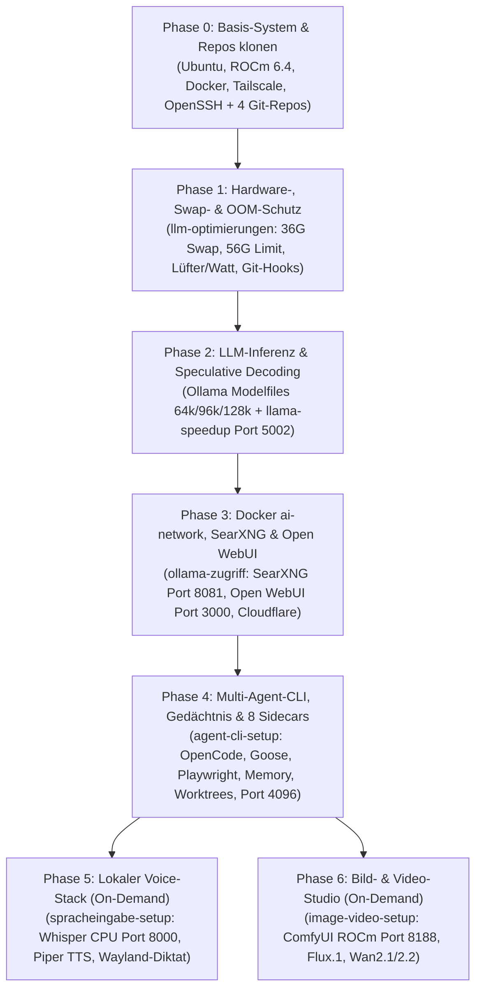

# 🏗️ Gesamtdokumentation: Komplettes KI-Ökosystem „From Scratch" aufbauen

> **Zielgruppe & Zweck:** Schritt-für-Schritt-Masterplan, um das gesamte lokale KI-, Agenten-, Web-, Voice- und Bild/Video-Setup auf einer frisch installierten Ubuntu-Workstation (mit AMD Radeon PRO W7800 48 GB VRAM) **von Null an („From Scratch")** anhand der vorhandenen Git-Repositories vollständig reproduzierbar wiederherzustellen.

---

## 🗺️ 1. Grafischer Ablaufplan: Die 7 Aufbau-Phasen in der richtigen Reihenfolge

Damit Abhängigkeiten (wie das Docker-Netzwerk `ai-network`, ROCm-Kernel-Limits, Ollama-Templates und Symlinks) sofort beim ersten Durchlauf greifen, wird das Setup in **7 aufeinander aufbauenden Phasen** ausgeführt:



---

## 📦 Phase 0: Grundsystem vorbereiten & die 4 Haupt-Repositories klonen

### 1. System-Basis (Ubuntu Linux, ROCm, Docker, Tailscale, SSH)
Auf einem frischen Ubuntu-System werden zuerst die System-Dienste installiert:
```bash
# 1. Basis-Pakete, OpenSSH-Server, Tmux, Git, Python & Build-Tools:
sudo apt update && sudo apt install -y \
  git curl jq tmux htop nvtop build-essential python3 python3-pip python3-venv \
  openssh-server wl-clipboard wtype libnotify-bin pipewire-audio-client-libraries

# 2. SSH-Server dauerhaft beim Booten aktivieren:
sudo systemctl enable --now ssh

# 3. Tailscale VPN installieren & verbinden (für 100.x.y.z Mesh-Zugriff):
curl -fsSL https://tailscale.com/install.sh | sh
sudo tailscale up

# 4. Ollama installieren (Port 11434):
curl -fsSL https://ollama.com/install.sh | sh
```
* **Weiterführende Detail-Doku:**
  * [Docker nativ ohne Desktop installieren (`ollama-zugriff/docs/DOCKER_NATIV_OHNE_DESKTOP_LEITFADEN.md`)](file:///home/clemi/Projekte/LLM/ollama-zugriff/docs/DOCKER_NATIV_OHNE_DESKTOP_LEITFADEN.md)
  * [Tailscale & Cloudflare Sicherheitsarchitektur (`agent-cli-setup/docs/04_NETZWERK_TAILSCALE_CLOUDFLARE_DATENSCHUTZ.md`)](file:///home/clemi/Projekte/LLM/agent-cli-setup/docs/04_NETZWERK_TAILSCALE_CLOUDFLARE_DATENSCHUTZ.md)

### 2. Workspace `/home/clemi/Projekte/LLM` anlegen & Repositories klonen
```bash
mkdir -p /home/clemi/Projekte/LLM/{docs,scripts}
cd /home/clemi/Projekte/LLM

# Die 4 Kern-Repositories klonen:
git clone git@github.com:globalx-prog/llm-optimierungen.git
git clone git@github.com:globalx-prog/ollama-zugriff.git
git clone git@github.com:globalx-prog/image-video-setup.git
git clone git@github.com:globalx-prog/agent-cli-setup.git
```

---

## ⚙️ Phase 1: Hardware-Tuning, Swap/OOM-Schutz & Globale Git-Hooks (`llm-optimierungen`)

> **Ziel:** Verhindert System-Freezes bei 70B/80B-Modellen, richtet den 36 GB NVMe-Swap inkl. `clearswap` ein, konfiguriert die W7800 Lüfter-/Watt-Steuerung (`200W` vs. `230W`) und aktiviert den globalen Git-Hook-Schutz gegen versehentliche GGUF-/Key-Commits.

### Auszuführende Setup-Skripte:
```bash
cd /home/clemi/Projekte/LLM/llm-optimierungen

# 1. Ollama Systemd-Overrides (FlashAttention, 56 GB RAM-Limit, OOM-Schutz) & Kernel-Tuning:
sudo ./setup/01-apply-ollama-oom-fix.sh

# 2. Pre-Commit & Globale Git-Hooks (Conventional Commits, 2-MB-Sperre, Secret-Scan) aktivieren:
./setup/03-setup-pre-commit.sh
./setup/04-setup-global-hooks.sh

# 3. GPU-Modus nach Wunsch testen (Daily 200W Silent vs. Performance 230W + 65% Lüfter):
./scripts/set-gpu-mode-daily.sh
# Optional bei Dauerlast: ./scripts/set-gpu-mode-performance.sh
```

### Weiterführende Detail-Dokumentation in [`llm-optimierungen/`](file:///home/clemi/Projekte/LLM/llm-optimierungen/README.md):
* **README & Übersicht:** [`llm-optimierungen/README.md`](file:///home/clemi/Projekte/LLM/llm-optimierungen/README.md)
* **Swap, ROCm-Stabilität & `clearswap`:** [`llm-optimierungen/docs/SYSTEM_TUNING_SWAP_UND_STABILITAET.md`](file:///home/clemi/Projekte/LLM/llm-optimierungen/docs/SYSTEM_TUNING_SWAP_UND_STABILITAET.md)
* **W7800 Lüftersteuerung & Thermik (-24 °C Hotspot):** [`llm-optimierungen/docs/LEISTUNG_LUEFTER_SCHALTUNG_UND_PERFORMANCE_GEWINN.md`](file:///home/clemi/Projekte/LLM/llm-optimierungen/docs/LEISTUNG_LUEFTER_SCHALTUNG_UND_PERFORMANCE_GEWINN.md) & [`llm-optimierungen/docs/LUEFTERSTEUERUNG_LACT_UND_HARDWARE_KOEXISTENZ.md`](file:///home/clemi/Projekte/LLM/llm-optimierungen/docs/LUEFTERSTEUERUNG_LACT_UND_HARDWARE_KOEXISTENZ.md)
* **VRAM-Grenzen (41-GiB-Regel) & Speicherallokation:** [`llm-optimierungen/docs/vram-und-modell-leitfaden.md`](file:///home/clemi/Projekte/LLM/llm-optimierungen/docs/vram-und-modell-leitfaden.md) & [`llm-optimierungen/docs/SPEICHERBEDARF_UND_HARDWARE_ALLOKATION.md`](file:///home/clemi/Projekte/LLM/llm-optimierungen/docs/SPEICHERBEDARF_UND_HARDWARE_ALLOKATION.md)
* **Git-Hooks Handbuch:** [`llm-optimierungen/docs/git-hooks-anleitung.md`](file:///home/clemi/Projekte/LLM/llm-optimierungen/docs/git-hooks-anleitung.md)

---

## 🚀 Phase 2: LLM-Inferenz, Maximierte Kontexte & Speculative Decoding (`Port 11434` & `Port 5002`)

> **Ziel:** Erstellt die optimierten Ollama-Modelle mit 100%-VRAM-Kontext (`64k` Quality, `128k` Speed, `96k` Distill) sowie den `llama-speedup` Speculative-Decoding-Stack auf Port `5002` (+269 % Beschleunigung für 70B/72B-Modelle).

### Auszuführende Schritte:
```bash
# 1. Basis-Modelle in Ollama laden (falls noch nicht vorhanden):
ollama pull qwen3-coder:30b
ollama pull deepseek-r1:70b
ollama pull llama3.3:70b

# 2. Maßgeschneiderte Ollama-Modelfiles bauen:
cd /home/clemi/Projekte/LLM/llm-optimierungen/modelfiles
ollama create qwen3-coder-quality -f Modelfile.qwen3-coder-quality
ollama create qwen3-coder-speed   -f Modelfile.qwen3-coder-speed
ollama create qwen3.8-35b-distill -f Modelfile.distill35b
ollama create deepseek-r1-70b-speed -f Modelfile.deepseek-r1-70b-speed

# 3. Qwen3 Multi-Turn Tool-Call Template & maximierte Kontexte (64k/96k/128k) patchen:
/home/clemi/Projekte/LLM/agent-cli-setup/scripts/fix_ollama_tool_templates.sh

# 4. Speculative Decoding Stack (Port 5002) vorbereiten & starten:
cd /home/clemi/Projekte/LLM/llm-optimierungen/llm-speedup
./setup/model-download-setup.sh
docker compose up -d
```

### Weiterführende Detail-Dokumentation in [`llm-optimierungen/`](file:///home/clemi/Projekte/LLM/llm-optimierungen/README.md):
* **Speculative Decoding Handbuch (+269 % Speedup):** [`llm-optimierungen/llm-speedup/README.md`](file:///home/clemi/Projekte/LLM/llm-optimierungen/llm-speedup/README.md)
* **Master-Benchmark aller Modelle:** [`llm-optimierungen/docs/MODELL_UEBERSICHT_UND_BEWERTUNG.md`](file:///home/clemi/Projekte/LLM/llm-optimierungen/docs/MODELL_UEBERSICHT_UND_BEWERTUNG.md) & [`llm-optimierungen/docs/BENCHMARK_RESULTS.md`](file:///home/clemi/Projekte/LLM/llm-optimierungen/docs/BENCHMARK_RESULTS.md)
* **Kontextmatrix & Stellschrauben:** [`llm-optimierungen/docs/MODELL_GESCHWINDIGKEITEN_STELLSCHRAUBEN_KONTEXTMATRIX.md`](file:///home/clemi/Projekte/LLM/llm-optimierungen/docs/MODELL_GESCHWINDIGKEITEN_STELLSCHRAUBEN_KONTEXTMATRIX.md) & [`llm-optimierungen/docs/kontext-und-speicher-strategien.md`](file:///home/clemi/Projekte/LLM/llm-optimierungen/docs/kontext-und-speicher-strategien.md)
* **Lokale Top-5 vs. Cloud-Flaggschiffe:** [`llm-optimierungen/docs/LOKALE_TOP5_VS_CLOUD_FLAGGSCHIFFE.md`](file:///home/clemi/Projekte/LLM/llm-optimierungen/docs/LOKALE_TOP5_VS_CLOUD_FLAGGSCHIFFE.md)

---

## 🌐 Phase 3: Docker-Netzwerk `ai-network`, SearXNG (`Port 8081`) & Open WebUI (`ollama-zugriff`)

> **Ziel:** Erstellt das zentrale Docker-Bridge-Netzwerk `ai-network`, startet die private Metasuchmaschine **SearXNG (`Port 8081`)** für deine Agenten sowie **Open WebUI (`Port 3000`)** und den **Cloudflare Zero Trust Tunnel** (`openwebui.deine-domain.de`).

### Auszuführende Setup-Skripte:
```bash
cd /home/clemi/Projekte/LLM/ollama-zugriff

# 1. Docker-Netzwerk 'ai-network' erstellen:
./setup/01-create-network.sh

# 2. (Bei Neuinstallation) Cloudflare Tunnel-Token in tunnel/.env eintragen:
# cp tunnel/.env.example tunnel/.env && nano tunnel/.env

# 3. Gesamten Web- & Such-Stack (Open WebUI + SearXNG + Tunnel) starten:
./setup/02-deploy-stack.sh

# 4. Status prüfen:
./scripts/status.sh
```

### Weiterführende Detail-Dokumentation in [`ollama-zugriff/`](file:///home/clemi/Projekte/LLM/ollama-zugriff/README.md):
* **README & Schnellstart:** [`ollama-zugriff/README.md`](file:///home/clemi/Projekte/LLM/ollama-zugriff/README.md)
* **Cloudflare Zero Trust Tunnel, Härtung & Rollback:** [`ollama-zugriff/docs/cloudflare-tunnel-und-sicherheit.md`](file:///home/clemi/Projekte/LLM/ollama-zugriff/docs/cloudflare-tunnel-und-sicherheit.md)
* **Open WebUI Bildgenerierung & Modell-Kombinationen:** [`ollama-zugriff/docs/OPEN_WEBUI_BILDGENERIERUNG_UND_MODELL_KOMBINATIONEN.md`](file:///home/clemi/Projekte/LLM/ollama-zugriff/docs/OPEN_WEBUI_BILDGENERIERUNG_UND_MODELL_KOMBINATIONEN.md)

---

## 🤖 Phase 4: Multi-Agent-CLI, Lokales Gedächtnis, 8 Sidecars & Handy-Autostart (`agent-cli-setup`)

> **Ziel:** Installiert `OpenCode` und `Goose`, richtet den Headless-Browser (`Playwright MCP`), die lokale `SearXNG`-Brücke und das **0-MB-VRAM Langzeit-Gedächtnis (`MEMORY.md` + `agent_memory.db`)** ein, initialisiert die **3 isolierten Git-Worktrees** und aktiviert den **Handy-Webserver (`Port 4096`)** beim Systemstart.

### Auszuführende Setup-Skripte:
```bash
cd /home/clemi/Projekte/LLM/agent-cli-setup

# 1. OpenCode CLI & Goose CLI installieren + PATH dauerhaft in ~/.bashrc verankern:
./setup/01-install-cli-tools.sh

# 2. Playwright MCP & lokales Chromium für /webtest installieren:
./setup/02-install-mcp-playwright.sh

# 3. Konfigurationen (opencode.json, Subagenten, Goose) nach ~/.config verlinken:
./setup/03-link-agent-configs.sh

# 4. Isolierte Git-Worktrees (coding, testing, review) + lokales Backup-Remote anlegen:
./scripts/setup_worktrees.sh

# 5. Lokales Langzeit-Gedächtnis mit den 10 Goldenen Systemregeln initialisieren:
./scripts/memory.sh reset-defaults

# 6. Handy-Webserver (http://100.x.y.z:4096) als Systemd-Autostart aktivieren:
./scripts/autostart_remote_service.sh enable

# 7. Kompletten Hardware-, ROCm- & MCP-Protokoll-Selbsttest ausführen:
./setup/04-verify-amd-rocm-inference.sh
./scripts/status.sh
```

### Weiterführende Detail-Dokumentation in [`agent-cli-setup/`](file:///home/clemi/Projekte/LLM/agent-cli-setup/README.md):
* **README & Modus-Matrix (Modi 1–6):** [`agent-cli-setup/README.md`](file:///home/clemi/Projekte/LLM/agent-cli-setup/README.md)
* **01 — Architektur & Tool-Interaktion:** [`agent-cli-setup/docs/01_ARCHITEKTUR_UND_TOOL_INTERAKTION.md`](file:///home/clemi/Projekte/LLM/agent-cli-setup/docs/01_ARCHITEKTUR_UND_TOOL_INTERAKTION.md)
* **02 — Hardware & VRAM-Strategie (W7800):** [`agent-cli-setup/docs/02_HARDWARE_UND_VRAM_STRATEGIE_W7800.md`](file:///home/clemi/Projekte/LLM/agent-cli-setup/docs/02_HARDWARE_UND_VRAM_STRATEGIE_W7800.md)
* **03 — Vergleich Antigravity vs. Local Stack:** [`agent-cli-setup/docs/03_VERGLEICH_ANTIGRAVITY_VS_LOCAL_STACK.md`](file:///home/clemi/Projekte/LLM/agent-cli-setup/docs/03_VERGLEICH_ANTIGRAVITY_VS_LOCAL_CONFIG.md) *(bzw. [`03_VERGLEICH_ANTIGRAVITY_VS_LOCAL_STACK.md`](file:///home/clemi/Projekte/LLM/agent-cli-setup/docs/03_VERGLEICH_ANTIGRAVITY_VS_LOCAL_STACK.md))*
* **05 — Git-Worktree & Multi-Agenten-Workflow:** [`agent-cli-setup/docs/05_WORKTREE_UND_MULTI_AGENTEN_WORKFLOW.md`](file:///home/clemi/Projekte/LLM/agent-cli-setup/docs/05_WORKTREE_UND_MULTI_AGENTEN_WORKFLOW.md)
* **06 & 07 — Große Projekte & Copy-Paste-Vorlagen:** [`agent-cli-setup/docs/06_PRAXIS_LEITFADEN_GROSSE_PROJEKTE_UND_BEDIENUNG.md`](file:///home/clemi/Projekte/LLM/agent-cli-setup/docs/06_PRAXIS_LEITFADEN_GROSSE_PROJEKTE_UND_BEDIENUNG.md) & [`agent-cli-setup/docs/07_ANWENDUNGSBEISPIELE_UND_KOPIERVORLAGEN.md`](file:///home/clemi/Projekte/LLM/agent-cli-setup/docs/07_ANWENDUNGSBEISPIELE_UND_KOPIERVORLAGEN.md)
* **08 — Kompletthandbuch (Multi-Model-Pipeline, 8 Sidecars, Android/Termius, Autostart):** [`agent-cli-setup/docs/08_KOMPLETTHANDBUCH_WORKFLOWS_MODELLE_UND_ERWEITERUNGEN.md`](file:///home/clemi/Projekte/LLM/agent-cli-setup/docs/08_KOMPLETTHANDBUCH_WORKFLOWS_MODELLE_UND_ERWEITERUNGEN.md)
* **09 — Täglicher Praxis-Guide & beste Tool-Kombinationen:** [`agent-cli-setup/docs/09_TAEGLICHER_PRAXIS_GUIDE_UND_TOOL_KOMBINATIONEN.md`](file:///home/clemi/Projekte/LLM/agent-cli-setup/docs/09_TAEGLICHER_PRAXIS_GUIDE_UND_TOOL_KOMBINATIONEN.md)
* **10 — Lokales Dual-Gedächtnis (`MEMORY.md` + SQLite MCP) & Default-Profile:** [`agent-cli-setup/docs/10_LOKALES_GEDAECHTNIS_UND_DEFAULT_CONFIG.md`](file:///home/clemi/Projekte/LLM/agent-cli-setup/docs/10_LOKALES_GEDAECHTNIS_UND_DEFAULT_CONFIG.md)

---

## 🎙️ Phase 5: Lokaler Voice-Stack — Spracheingabe & TTS (`llm-optimierungen/spracheingabe-setup`)

> **Ziel:** Startet den CPU-basierten `faster-whisper-large-v3-turbo` Dienst (`Port 8000`, **0 MB VRAM!**) sowie `piper-tts` (`Port 10200`) im `ai-network` und richtet das systemweite Wayland Push-to-Talk-Diktat (`Super + V`) ein.

### Auszuführende Schritte:
```bash
cd /home/clemi/Projekte/LLM/llm-optimierungen/spracheingabe-setup

# 1. Wayland Audio- & Clipboard-Abhängigkeiten installieren:
./setup/01-install-audio-deps.sh

# 2. Whisper-STT (Port 8000) & Piper-TTS (Port 10200) Container starten:
docker compose up -d

# 3. 3-Sekunden-Mikrofon- & Transkriptions-Test durchführen:
./scripts/test_stt.sh
```
*(Optional: In den Ubuntu-Tastatureinstellungen den Shortcut `Super + V` auf `/home/clemi/Projekte/LLM/scripts/dictate_wayland.sh` legen).*

### Weiterführende Detail-Dokumentation:
* **README & Open WebUI / VS Code Anbindung:** [`llm-optimierungen/spracheingabe-setup/README.md`](file:///home/clemi/Projekte/LLM/llm-optimierungen/spracheingabe-setup/README.md)
* **Vollständige Einrichtungsanleitung:** [`llm-optimierungen/spracheingabe-setup/docs/spracheingabe-anleitung.md`](file:///home/clemi/Projekte/LLM/llm-optimierungen/spracheingabe-setup/docs/spracheingabe-anleitung.md)

---

## 🎨 Phase 6: Bild- & Video-Generierung mit ComfyUI (`image-video-setup`)

> **Ziel:** Installiert ComfyUI nativ für AMD ROCm (`Port 8188`), wendet die W7800-Speicherfixes an und lädt bei Bedarf die Bild-/Videomodelle (Flux, Wan2.2).

### Auszuführende Setup-Skripte:
```bash
cd /home/clemi/Projekte/LLM/image-video-setup

# 1. ComfyUI nativ mit ROCm-PyTorch installieren:
./setup/01-install-comfyui-native.sh

# 2. Spezifische AMD W7800 GPU-Fixes anwenden:
./setup/02-apply-amd-gpu-fixes.sh

# 3. Speicher- & Swap-Schutz für große Video-Workflows einrichten:
./setup/03-setup-memory-and-swap-protection.sh

# 4. (Optional) Wan 2.2 Video- & Flux.2 Bild-Modelle herunterladen:
# ./setup/04-download-wan2.2-models.sh
# ./setup/05-download-flux2-models.sh
```

### Weiterführende Detail-Dokumentation in [`image-video-setup/`](file:///home/clemi/Projekte/LLM/image-video-setup/README.md):
* **README & Inhaltsverzeichnis aller 21 Guides:** [`image-video-setup/README.md`](file:///home/clemi/Projekte/LLM/image-video-setup/README.md) & [`image-video-setup/docs/00-inhaltsverzeichnis-dokumentation.md`](file:///home/clemi/Projekte/LLM/image-video-setup/docs/00-inhaltsverzeichnis-dokumentation.md)
* **Gesamthandbuch Bild- & Video-KI:** [`image-video-setup/docs/01-handbuch-bild-und-video-ki.md`](file:///home/clemi/Projekte/LLM/image-video-setup/docs/01-handbuch-bild-und-video-ki.md)
* **Koexistenz & Sicherheit Ollama + ComfyUI:** [`image-video-setup/docs/02-sicherheitsguide-ollama-comfyui.md`](file:///home/clemi/Projekte/LLM/image-video-setup/docs/02-sicherheitsguide-ollama-comfyui.md)
* **Speicher-, Nodes- & Benchmark-Guides:** [`03-speicher-und-workflow-guide.md`](file:///home/clemi/Projekte/LLM/image-video-setup/docs/03-speicher-und-workflow-guide.md), [`04-nodes-und-workflows.md`](file:///home/clemi/Projekte/LLM/image-video-setup/docs/04-nodes-und-workflows.md), [`05-bild-und-video-benchmark.md`](file:///home/clemi/Projekte/LLM/image-video-setup/docs/05-bild-und-video-benchmark.md)

---

## ✅ Phase 7: Abschließender Gesamt-Check (Ist alles bereit?)

Nach dem Durchlaufen der Phasen prüfst du mit **3 Befehlen**, ob alle Ports, Modelle, Sidecars und das Gedächtnis grün melden:

```bash
# 1. Hardware-, ROCm-, Ollama-, Speedup- & SearXNG-Check:
/home/clemi/Projekte/LLM/agent-cli-setup/scripts/status.sh

# 2. Gedächtnis-Check (10 Goldene Regeln geladen?):
/home/clemi/Projekte/LLM/scripts/memory.sh list

# 3. Sidecar-Manager & Handy-Autostart prüfen:
/home/clemi/Projekte/LLM/scripts/sidecar_manager.sh status
/home/clemi/Projekte/LLM/agent-cli-setup/scripts/autostart_remote_service.sh status
```
Danach startest du deine tägliche Arbeit einfach über:
```bash
/home/clemi/Projekte/LLM/agent-cli-setup/scripts/start_agent_session.sh
```

